# 要件定義書：被災者支援つなぎ記録（仮称）

- 版：v1.0（2026-11-10。開発終了時点）
- 作成：鈴木（下書きはClaude）
- チーム：team_analysis
- 下敷き：[要件定義書前_前提まとめ.md](要件定義書前_前提まとめ.md)（前提・背景・目的・To-Be／As-Is／Gap・要因・解決策）、[背景・目的と課題意識_避難生活から生活再建まで.md](背景・目的と課題意識_避難生活から生活再建まで.md)（詳しい根拠）
- 読む人：正井・ゆうき（チームメンバー）
- 文中の［数字］は、末尾の出典の番号である。
- **v1.0 は、開発を終えた時点の実装から逆算して書き直した版である。** 5〜12章は、提出したアプリ（[02_app](../02_app)・[03_sql](../03_sql)）が実際に満たしていることを書く。作らなかったことと今後の課題は5-5と12章に書く。開発中に足した要件の経緯は15章にまとめる。

---

## 1. 前提

### 1-1. コンペの条件

- 大会のテーマは「Own the Why, Build with Intent.」である。
- チームでは、テーマを次のように解釈している。
  - Own the Why：プロダクトの選定をユーザーが責任を持って意思決定する。
  - Build with Intent：ユーザーの実現したいを起点とし、狙い通りのプロダクトを構築する。
- カテゴリは、災害における医療・福祉とする。
- メインの技術はGoogle技術とし、実行基盤にはGoogle Cloudを使う。他社のAIツールを前面に出さない。
- 提出の締切（コードフリーズ）は、2026年11月10日19:00である。デプロイしたURLは、11月14日のRegional Dayまで動かし続ける。
- 審査は8項目を0〜3点で採点する。チームでは、採点の基準を[達成条件.md](達成条件.md)の言葉で判断する。
- APIキーなどの秘密情報は、リポジトリにコミットしない。
- 根拠：[定義.md](定義.md)、[Kickoff動画メモ](../02_memo/2026-11-01_Kickoff動画メモ.md)

### 1-2. 対象の範囲

#### 災害から日常の生活に戻るまでのフロー

災害が起きてから日常の生活に戻るまでを、次の5つの段階に分ける。段階が進むほど期間は長くなり、被災者の居場所と支える人も変わっていく。

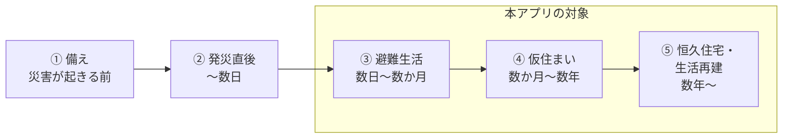

- **① 備え（災害が起きる前）**
  - すること：市町村が、自力で避難するのが難しい人の名簿（避難行動要支援者名簿）と、一人ひとりの避難の方法を決めた計画（個別避難計画）を作る。［3］住民は、避難場所と避難経路を決め、食料などを準備する。
  - 主に支える人：市町村
- **② 発災直後（〜数日）**
  - すること：危険な場所から逃げて、家族の安否を確かめる。自力で避難するのが難しい人は、手助けを受けて逃げる。
  - 主に支える人：家族、近所の人、避難を手伝う人
- **③ 避難生活（数日〜数か月）**
  - 居場所：避難所・福祉避難所のほか、自宅、車中泊、ホテルなどの2次避難先、病院、介護施設など、場所が分かれる。避難先の移動や転院も起きる。［1］［9］
  - すること：持病のある人や高齢者が、避難しながら医療や介護を受け続ける。
  - 主に支える人：保健師、自衛隊、NPOなど［16］
- **④ 仮住まい（数か月〜数年）**
  - 居場所：仮設住宅（建設型）や、借り上げた賃貸住宅（賃貸型の仮設住宅）など
  - すること：健康を保ちながら、次の住まいを決める。
  - 主に支える人：市町が置く地域支え合いセンターの相談員。見守りと相談を続ける。［12］
- **⑤ 恒久住宅・生活再建（数年〜）**
  - 居場所：再建した自宅、災害公営住宅など
  - すること：支援金などの制度を使って自宅を再建するか、災害公営住宅などへ移る。［4］支援金などの制度は、本人が申請しないと受けられない。［13］
  - 主に支える人：市町の担当部署、相談員

#### 対象とする段階

- 5つの段階のうち、③ 避難生活・④ 仮住まい・⑤ 恒久住宅・生活再建を対象とする。
- この3つに絞る理由は、次のとおりである。
  - 能登の災害関連死のうち、発災から1週間を過ぎて亡くなった人は9割を超える。［1］
  - Googleの災害対応は① 備えと② 発災直後が中心で、③〜⑤の医療や福祉を支える取り組みは見つからなかった。［5］［6］［7］
  - 見守りと相談の支援は2年余りで41万件を超え、支援が数年続く。［10］

### 1-3. 開発の前提

- 開発の期間は、2026年11月5日10:00から11月10日19:00までである。11月10日に開発を終えた。
- 費用は、**各サービスの無料枠の中だけに収める**。Cloud Credit（1チーム20ドル）は、無料枠を超えたときの保険として最後に使い、前提にしない。Cloud CreditはGoogle AI Studioには使えない。
- デモのデータは事前に登録しない。組織・被災者・施設・記録は、デモのときに画面から入力して確かめる。入れるのは**架空の人物の情報だけ**とし、実在の人の氏名や健康の状態は入れない（GeminiをAI Studioの無料枠で呼ぶため、送った内容がGoogleの製品の改善に使われる。11-3）。事前に登録するのは、出典のある全国共通の支援制度の情報（8件）だけとする。
- 本番での運用・保守は行わない。動くプロトタイプを作るところまでとする。公開したURLは、11月14日のRegional Dayまで動かし続ける。

---

## 2. 背景

段階のフローは1-2を参照。

### 2-1. Googleが関わっている段階

- ① 備え：台風が来る数日前から、進路と通過の時期をGoogleマップに表示している。［7］
- ② 発災直後：地震や津波の警報をGoogle検索とGoogleマップに表示している。［5］
- ② 発災直後：東日本大震災では、安否情報を一か所で検索できるパーソンファインダーを提供した。［6］
- ③〜⑤では、医療や福祉を支える取り組みは見つからなかった。

### 2-2. ③〜⑤で起きていること

- **③ 避難生活**
  - 能登の災害関連死286事例のうち、66%は発災から3か月以内に亡くなった。［1］
  - 経緯に多い事情は、断水（164件）・停電（136件）・避難場所の移動（86件）・転院（79件）である（延べ数）。［1］
  - 発災から約1.5か月後、避難所の外の人は避難所の人とほぼ同じ数いた。［8］
  - 避難所の名簿は紙で様式もばらばらで、健康や福祉の情報は移った先の施設に渡らなかった。［9］
- **④ 仮住まい**
  - 能登の災害関連死の約3分の1は、発災から3か月以降に起きている。［1］
  - 市町の地域支え合いセンターでは、相談員が不足している。［12］
- **⑤ 恒久住宅・生活再建**
  - 支援金などの制度は、本人が申請しないと受けられない。［13］
  - 加算支援金を受けない理由には、役所に出向くのが難しい（14.8%）や手続きが複雑（6.6%）がある。［14］

---

## 3. 目的

### 3-1. プロジェクトの目的

- 11月10日19:00までに、審査基準（[達成条件.md](達成条件.md)）を満たす、動くWebアプリを提出する。
- 決勝（11月27日 Demo Day）に進むことを狙う。

### 3-2. サービスの目的

- **③ 避難生活**
  - 断水や停電が起きても、持病のある人や高齢者が医療や介護を受け続けられるようにする。
  - 避難先の移動や転院による心身の負担を減らす。
  - 自宅や避難所の外で過ごす人の体調の異変に、早く気づけるようにする。
  - 専門職がついていない人でも、自分から困りごとを相談して支援につながれるようにする。
- **④ 仮住まい**
  - 相談員が足りない中でも、被災しなかった人の手も借りて、仮設住宅などの見守りを続けられるようにする。
  - 仮設住宅などで暮らす被災者の体調の異変に早く気づき、支援につなげる。
- **⑤ 恒久住宅・生活再建**
  - 被災者が、受けられる支援を漏れなく受けられるようにする。
  - 役所に出向けない人や手続きを複雑と感じる人でも、申請できるようにする。

---

## 4. To-Be／As-Is／Gap・要因・解決策・解決策の決定要因

To-Be・As-Is・Gapの番号は対応する。

### 4-1. To-Be（あるべき姿）

③ 避難生活

1. 持病のある人や高齢者が、医療や介護を途切れずに受けられている。
2. 支援が必要な人の居場所と状態を、避難所の内外を問わず行政や支援者がつかめている。
3. 移った先の施設や支援者に、持病や必要な介護の情報が引き継がれている。

④ 仮住まい

4. 仮設住宅などで暮らす被災者の健康の悪化の兆しが、早く見つかり支援につながっている。
5. 支援者が、仮設住宅などの見守りを無理なく続けられている。
6. 被災者が、次の住まいへ移る見通しを持てている。

⑤ 恒久住宅・生活再建

7. 被災者が、受けられる支援を漏れなく受けている。
8. 被災者が、できるだけ早く恒久住宅に移り日常の生活に戻れている。

### 4-2. As-Is（現状）

③ 避難生活

1. 持病のある人や高齢者が、医療や介護を途切れずに受けられていない。
2. 支援が必要な人の居場所と状態を、避難所の外では行政や支援者がつかめていない。
3. 移った先の施設や支援者に、持病や必要な介護の情報が引き継がれていない。

④ 仮住まい

4. 仮設住宅などで暮らす被災者の健康の悪化の兆しが、早く見つからず支援につながっていない。
5. 支援者が、仮設住宅などの見守りを無理なく続けられていない。
6. 被災者が、次の住まいへ移る見通しを持てていない。

⑤ 恒久住宅・生活再建

7. 被災者が、受けられる支援を漏れなく受けていない。
8. 被災者が、早く恒久住宅に移れていない。

### 4-3. Gap（To-BeとAs-Isの差）

③ 避難生活

1. 持病のある人や高齢者の医療や介護が、避難生活の中で途切れてしまう。
2. 避難所の外にいる支援が必要な人の居場所と状態が、行政や支援者から見えない。
3. 持病や必要な介護の情報が、移った先の施設や支援者に届かない。

④ 仮住まい

4. 仮設住宅などで暮らす被災者の健康の悪化の兆しが見逃され、支援が遅れる。
5. 見守りの負担が支援者に重くのしかかり、無理なく続けられない。
6. 被災者が、次の住まいへ移る見通しを持てないまま仮住まいを続けている。

⑤ 恒久住宅・生活再建

7. 受けられるはずの支援のうち、受け取られていないものがある。
8. 恒久住宅に移り日常の生活に戻るまでに、時間がかかりすぎている。

### 4-4. 要因

Gapが生じている要因を書く。

1. **断水や停電で、介護施設や病院の機能が落ちる。**
   - 断水による介護施設等への影響は69件で、停電による介護施設等への影響は59件だった（延べ数）。［1］
   - 災害関連死の64%は、亡くなる直前に病院や介護施設にいた。［1］
2. **避難先の移動や転院が重なり、心身の負担になる。**
   - 能登の災害関連死の経緯には、避難場所の移動が86件と転院が79件書かれている。［1］
3. **自宅や避難所の外で過ごす人の異変に、周りが気づきにくい。**
   - 能登の災害関連死の経緯には、自宅での避難生活の継続が46件と車中泊が28件書かれている。［1］
   - 県は本人に登録を呼びかけたが、必要性を感じない人が多く登録が進まなかった。［9］
4. **持病や必要な介護の情報が、移った先の施設や支援者に引き継がれない。**
   - 避難所の名簿は紙で様式もばらばらだった。［9］
   - 保健師・自衛隊・NPOなどの間では、情報を共有する仕組みづくりに手間取った。［16］
   - ただし災害関連死の事例集には、引き継ぎの失敗が書かれた事例は見当たらない。［1］
5. **相談員が足りない中で、見守りの量が多く期間も長い。**
   - 市町の地域支え合いセンターでは、相談員が不足している。［12］
   - 見守りと相談の支援は、2年余りで累計412,162件になった。［10］
6. **制度が申請主義のため、申請にたどり着けない人がいる。**
   - 支援金などの制度は、本人が申請しないと受けられない。［13］
   - 支援は担当部署ごとに分かれ、必要な情報も得にくい。［13］
   - 国は一人ひとりを訪ねて支援につなぐ災害ケースマネジメントを進めている。［15］

Gap 6とGap 8は次の住まいへ移るまでの時間の問題である。住宅を建てる時間そのものは、Webサービスで変えられる範囲が小さい。そのため、本アプリでは扱わない。

### 4-5. 解決策

4-4の要因に対して、1つのWebアプリで取り組む。

> **避難生活から生活再建まで、被災者一人ひとりの状態と支援の記録を被災者本人と支援者の間で引き継ぎ、必要な支援へ漏れなくつなぐWebアプリ**

### 4-6. 解決策の決定要因

1. **要因：断水や停電で介護施設や病院の機能が落ち、避難先の移動や転院が重なって、心身の負担になる。**
   - 取り組み：受け入れ先の施設の空きと対応できる介護を、支援者がすぐ確かめられるようにする。空きと断水・停電は、施設の職員が自分で更新できるようにする（F5）。
   - ねらい：機能が落ちた施設から移る先を早く決め、移動や転院の回数を減らす（仮説）。
2. **要因：自宅や避難所の外で過ごす人の異変に、周りが気づきにくい。本人に登録を呼びかけても、必要性を感じない人が多く進まない。**
   - 取り組み：訪問する保健師やケアマネジャーなどが、避難所の外の人の居場所と状態を同じ形で記録し、共有できるようにする（F2）。本人の登録を待たずに、訪問する人が記録する。
   - 取り組み：支援が必要だと感じた本人は、自分から状態や困りごとを相談できるようにする（F8）。住んでいる市区町村に支援の組織がまだ無い人も、相談を送れるようにする（組織を問わず専門職が返事をする「公開の相談」）。
   - 取り組み：自分で登録するのが難しい人は、離れて住む家族などが代わりに登録し、居場所を伝えられるようにする（F9）。
   - 取り組み：記録と相談から、悪化の兆しがある人を支援者に知らせる（F4）。
3. **要因：持病や必要な介護の情報が、移った先の施設や支援者に引き継がれない。避難所の名簿は紙で様式もばらばらで、支援者の間で情報を共有する仕組みがない。**
   - 取り組み：持病・薬・必要な介護を同じ項目で記録し、引き継ぎシートにして、移った先の施設や支援者へそのまま渡せるようにする（F3）。
4. **要因：相談員が足りない中で、見守りの量が多く期間も長い。**
   - 取り組み：見守りの内容を短く書くだけで、AIが同じ項目に整えるようにする（F2）。
   - 取り組み：悪化の兆しがある人や急ぎの相談がある人を一覧の上に並べ、訪ねる順番を決めやすくする（F4・F8、仮説）。
   - 取り組み：被災しなかったボランティアや家族などが見守りの担当に加われるようにし、支える人の数を増やす（F1・F2）。
5. **要因：支援金などの制度は本人が申請しないと受けられず、支援は担当部署ごとに分かれて情報も得にくいため、申請にたどり着けない人がいる。**
   - 取り組み：家の被害・世帯・再建の意向から、受けられそうな支援と申請先・期限を示す（F6）。
   - 取り組み：本人が自分の画面で申請の期限や進み具合を確かめ、役所に出向かなくても相談員に相談できるようにする（F6・F8）。
   - 取り組み：災害救助法の適用や受付中の支援など、住んでいる地域の状況を出典つきで本人と支援者に示す（F10）。
6. **すべての要因に共通すること：段階が変わるたびに、支える人と記録が分かれてしまう。**
   - 取り組み：被災者1人につき1つの記録を作り、③から⑤まで、本人と支援者の間で使い続ける（F1）。

---

## 5. サービス概要

### 5-1. サービスの内容

本アプリは、被災者1人につき1つの記録を作り、③ 避難生活から⑤ 生活再建まで、その記録を被災者本人と支援者の間で引き継ぐWebアプリである。支援者は、保健師やケアマネジャーなどの専門職だけでなく、被災しなかったボランティアや家族なども含む。被災者本人もアカウントを作り、自分の状態や困りごとを相談できる。

支援者や本人が短く書いた内容を、AI（Gemini）が同じ項目に整える。そのうえで、悪化の兆し・相談の急ぎの度合い・受けられる支援・引き継ぎシートの要約を、理由とともに示す。移る先の施設の候補は、AIを使わずルールで並べる。どれを採用するかは、支援者と本人が決める。

支援の組織（例：市町や地域支え合いセンター）は、アプリの中で専門職が作る。組織につながっていない本人や支援者も、使える範囲でアプリを使い始められる。

段階ごとにできることは、次のとおりである。

- **③ 避難生活**
  - 訪問した保健師などが、避難所の外の人も含めて、居場所と状態を同じ形で記録する。
  - 本人も、自分の居場所と状態・困りごとを書いて、相談員に相談できる。自分で登録するのが難しい人は、家族などが代わりに登録できる。
  - 移る先が必要なときは、空きと対応できる介護から受け入れ先の候補を確かめる。空きと断水・停電は、施設の職員が自分で更新する。
  - 移るときは、持病・薬・必要な介護を引き継ぎシートにまとめて、移る先に渡す。
- **④ 仮住まい**
  - 相談員が、被災しなかったボランティアや家族などを、見守りの担当として割り当てる。本人がそれを認める。
  - 相談員と担当の支援者が、見守りの内容を短く記録する。
  - 悪化の兆しがある人や、しばらく訪ねていない人、急ぎの相談がある人が一覧の上に並び、訪ねる順番を決めやすくなる。
- **⑤ 恒久住宅・生活再建**
  - 住宅の被害と世帯から、受けられそうな支援と申請先・期限が示される。
  - 本人は自分の画面で、受けられそうな支援・全国共通の支援制度の一覧・期限・相談員からの返事を確かめ、申請したことを記録できる。
  - 期限の近い未申請があれば、本人と相談員に知らせる。
- **どの段階でも**
  - 災害救助法の適用・受付中の支援・避難所・仮設住宅など、住んでいる地域と同じ県の状況を、出典つきで確かめられる。

### 5-2. ターゲット

本アプリのターゲットは、被災者本人と支援者である。支援者は、専門職と一般の支援者に分ける。

- **被災者本人：災害で支援が必要になった人**
  - 持病のある人や高齢者だけでなく、ケアマネジャーなどの専門職がついていない一般の人も含む。
- **支援者（専門職）：仕事として被災者を支える人**
  - 保健師、ケアマネジャー、地域支え合いセンターの相談員、医療・福祉の施設の職員など
- **支援者（一般）：被災しなかった人で、被災者を手伝う人**
  - ボランティア、NPOの人、近所の人、離れて住む家族や親せきなど
  - 相談員が足りない中で、見守りの手を増やすための立場である。家族は、本人の代わりに記録を登録することもある。
- **施設の職員：受け入れ先になる施設（福祉避難所・介護施設・病院など）で働く人**
  - 自分の施設の空きと、断水・停電の状況を知らせる。被災者の記録は扱わない。

### 5-3. サービス介入前と介入後

#### サービス介入前

① 備えと② 発災直後では、市町村の名簿やGoogleの警報・安否確認の仕組みが被災者を支えている。一方、③〜⑤では段階ごとに支える人と記録が分かれ、段階が変わるたびに情報が途切れる。③〜⑤を支えるGoogleの取り組みは見つからなかった。

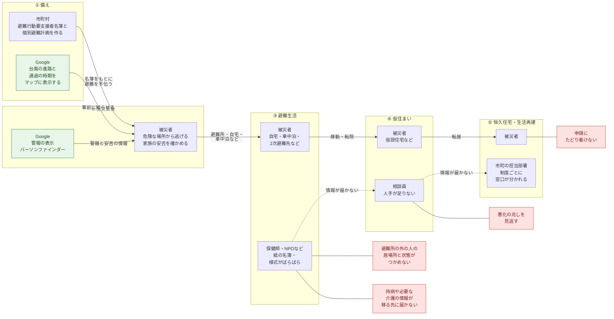

#### サービス介入後

① 備えと② 発災直後は、今のまま変えない。③から⑤まで、被災者1人につき1つの記録を本人と支援者の間で引き継ぐ。専門職だけでなく、一般の支援者と本人も記録に加わる。AIが記録を整え、候補と理由を出し、支援者と本人が決める。

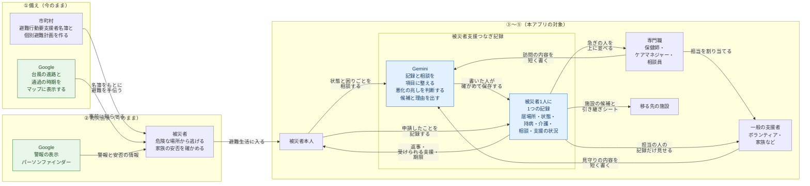

#### 変わること

- **① 備え・② 発災直後**：本アプリでは変えない。市町村の名簿とGoogleの警報・安否確認の仕組みが、今のまま支える。
- **③ 避難生活**：避難所の外の人の居場所と状態を、訪問した支援者が同じ形で記録し共有できる。本人も自分から相談できる。移るときは、持病や必要な介護の情報が引き継ぎシートで移る先に届く。
- **④ 仮住まい**：被災しなかった人が見守りの担当になり、相談員の手が増える。短く書くだけで記録がそろい、悪化の兆しや急ぎの相談がある人から順に訪ねられる。
- **⑤ 恒久住宅・生活再建**：受けられそうな支援と申請先・期限が示され、本人が自分の画面で確かめられる。役所に出向けない人でも、相談員とやり取りしながら申請を進められる。

### 5-4. 設計の考え方

1. **被災者1人につき1つの記録を、③から⑤まで使い続ける。** 居場所や担当の支援者が変わっても、同じ記録を引き継ぐ。
2. **支援者や本人が短く書いた内容を、AI（Gemini）が同じ項目に整える。** 相談員が足りない中でも、記録の手間を増やさない。
3. **AIは候補と理由を出し、決めるのは人である。** 整えた記録・悪化の兆し・支援の候補・引き継ぎシートの要約は、支援者や本人が確かめて採用するか直す。施設の候補（ルールで並べる）も、決めるのは専門職である。直したときは理由を残せる（テーマのOwn the Whyに合わせる）。本人の相談は、本人が書いた文章を正本とし、AIが整えた案は相談員が読む助けにとどめる。
4. **支える人の数を増やす。** 被災しなかったボランティアや家族も、担当として見守りに加われるようにする。施設の職員も、空きの情報を自分で入れる。
5. **見られる範囲を、立場と担当で分ける。** 本人は自分の記録だけ、一般の支援者は担当の人の記録だけ、家族は代わりに登録した人などの基本の情報と居場所だけ、施設の職員は自分の施設だけを扱う。一般の支援者を担当にするときは、本人が認める。
6. **AIの出力は、医療の診断や制度の可否の判定ではない。** 画面にもそのことを書く。
7. **組織がなくても使い始められる。** 組織は専門職がアプリの中で作り、参加コードで人を招く。組織につながっていない本人も、相談・健康の情報・受けられる支援を使える。
8. **AIが使えなくても止まらない。** Geminiが応答しないとき（無料枠の上限など）は、手入力に切り替えるか、既定の値で保存して、記録と相談を捨てない。

### 5-5. 対象外

1. 施設の空き情報を自動で集める仕組みや、自治体の被災者台帳などとのデータの連携（施設の情報は専門職が画面から登録・更新する）
2. 支援金などの申請そのものの代行・電子申請
3. メール・プッシュ通知などアプリの外への通知（アプリの画面の中で知らせる）
4. 医療の診断・治療の判断、救急の対応（命に関わるときは119番などへ連絡するよう画面で案内する）
5. 同じ人の記録が2つできたときに、あとから1つにまとめる機能（専門職に知らせるだけとする）
6. 一般の支援者の身元の確認（参加コードを配る組織が行う）
7. 住宅の再建や災害公営住宅の整備にかかる時間を短くすること（Gap 6・Gap 8）
8. ① 備えと② 発災直後の支援（市町村の名簿とGoogleの警報・安否確認の仕組みのままとする）
9. 日本語以外の言語への対応
10. 被災者の居場所の地図への表示（F7。Google Maps Platformを使う案だったが、開発の期間の中で作らなかった。12章）
11. 周りの地域の状況（F10）を、外部のページから自動で集めること（専門職が公開の情報を出典つきで入れる）
12. 施設の職員を施設から外す機能（参加コードを発行し直して、新しく入れないようにするだけとする）

---

## 6. 機能要件

4-5の解決策を実現するために、システムが満たすべき機能を「システムは〜すること」の形で定める。

| 機能 | 使う人 |
|---|---|
| F0 ログイン・立場・組織・プロフィール | 全員 |
| F1 被災者の記録と担当 | 全員 |
| F2 訪問・見守りの記録 | 専門職・一般の支援者 |
| F3 健康・介護の情報と引き継ぎ | 専門職・一般の支援者・本人 |
| F4 悪化の兆しの検知と訪問の順番 | 専門職・一般の支援者 |
| F5 受け入れ先の施設の確認 | 専門職・施設の職員 |
| F6 受けられる支援と申請の状況 | 専門職・本人 |
| F7 組織全体の状況 | 専門職 |
| F8 被災者からの相談 | 本人・専門職（公開の相談は支援者全員が読める） |
| F9 家族などによる代わりの登録とつなぎ | 一般の支援者（家族）・本人 |
| F10 周りの地域の状況 | 全員（入れるのは専門職） |

### F0. ログイン・立場・組織・プロフィール

利用者をGoogleアカウントか電話番号で識別し、立場（被災者本人・専門職・一般の支援者・施設の職員）と所属する組織（例：市町）を決める。組織は専門職がアプリの中で作る。

**ログイン**

- システムは、ログインしていない人にはログイン画面だけを表示し、ほかの画面と機能を使わせないこと。
- システムは、Googleアカウントでのログインと、電話番号でのログイン（SMSで届く確認コードを入れる）を提供すること（Firebase Authenticationを使う）。Googleアカウントを持たない高齢者なども、電話番号で使えるようにすること。
- システムは、ログインしたままにして、同じブラウザでは次から確認コードを求めないこと。ログアウトの前に「次は確認コードが要る」ことを確かめること。
- システムは、ログイン画面に前回のログインの方法（Googleか電話番号か）を表示すること。端末に覚えるのは方法の名前だけとし、電話番号は覚えないこと。
- システムは、プロフィールから、もう一方のログインの方法（Googleか電話番号）をつなげられるようにすること。つないだ後は、どちらでログインしても同じ利用者になること。つなごうとした電話番号が、登録の済んでいない別の利用者になっているときは、本人の確かめのうえでその利用者を消してつなぎ直せること（サーバーにFirebaseの利用者を消す権限は持たせない）。
- システムは、アプリのURLを1つにそろえ、別のURLで開かれたら決まったURLへ移すこと（ログインの状態がURLごとに分かれないようにするため）。
- システムは、利用者がいつでもログアウトできるようにすること。

**初回の登録**

- システムは、初回のログインで「支援を受けたい」か「支援をする」かを選ばせること。
  - **支援を受けたい（被災者本人）**：2段で登録する。1段目は都道府県・市区町村・お名前、2段目は今の段階・今いる場所（必須）と、年齢・世帯の人数・連絡先・住所・支援の組織（任意）とする。支援の組織は、住んでいる市区町村を受け持つ組織を上に出し、全国の組織から名前で探して選べること。選ばなくても登録できること。支援者が先に記録を作っていた場合は、受け取った確認コードを入れて、その記録とつなげる。
  - **支援をする**：表示名・職種・連絡先・活動する都道府県と市区町村・住所（すべて必須）と、参加コード（任意）を入れさせること。職種は保健師・ケアマネジャー・相談員・その他・該当なしから選ばせること。参加コードは専門職用・一般の支援者用・施設の職員用に分け、入れたコードで立場と組織（施設の職員は施設も）を決めること。参加コードを入れないときは、組織のない一般の支援者として登録すること。
- システムは、都道府県と市区町村を、全国の一覧（総務省の全国地方公共団体コード）から選ばせること。名前と読み（例：「わじま」）で絞り込めること。
- システムは、すでに登録が済んでいる人が登録の画面に来たときは、誤りを出さずにホームへ進めること。

**組織とオーナー**

- システムは、組織のない一般の支援者が、組織の名前と受け持つ市区町村を入れて組織を作れるようにすること。作った人は、その組織の専門職とオーナーになること。同じ市区町村で同じ名前の組織は作れないこと。
- システムは、組織を作ったときに専門職用と一般の支援者用の参加コードを発行すること。
- システムは、組織のオーナーが、自分の組織の参加コードをいつでも見られ、発行し直せる（前のコードは使えなくなる）ようにすること。オーナーは、同じ組織の専門職にオーナーの権限を付けたり外したりできること。最後の1人のオーナーは外せないこと。オーナーでない人には参加コードを見せないこと。
- システムは、組織のない支援者が、あとから参加コードを入れて組織に入れるようにすること。
- システムは、本人が登録の後も、プロフィールから支援の組織をつなぐ・変える・外すことができるようにすること。変える前に、新しい組織の専門職に記録が見えるようになることと、前の組織の担当が外れることを知らせること。

**プロフィール**

- システムは、プロフィールの画面で次を直せるようにすること。立場と所属する組織（本人の組織を除く）は、プロフィールでは変えないこと。
  - **支援者・施設の職員**：表示名・職種（専門職だけ）・連絡先・活動する市区町村・住所
  - **本人**：氏名・年齢・世帯の人数・連絡先・住所・支援の組織
- システムは、前から登録している支援者で必須の項目が空の人に、ホームでプロフィールを入れるよう案内すること（使うのは止めない）。
- システムは、プロフィールで文字の大きさ（ふつう・大きい）を選べるようにすること。本人は、選んでいなければ「大きい」で始めること。

**立場と見られる範囲**

- システムは、バックエンドへのすべての要求でログインの証明（IDトークン）を確かめ、確かめられない要求を断ること。立場と組織は、要求のたびにデータベースから読み直すこと。
- システムは、立場ごとに次の範囲だけを表示・更新させること（詳しくは10-3）。
  - **被災者本人**：自分の記録だけ。支援者が書いた訪問・見守りの記録の本文と、悪化の兆しの度合い・相談の急ぎの度合いは表示しない（支援者向けのメモであり、診断と誤解されないため）。
  - **専門職**：所属する組織の被災者すべての記録と、公開の相談（F8）。
  - **一般の支援者**：担当になった被災者の記録だけ。施設の情報（F5）と支援制度（F6）は扱わない。家族としてつながった記録は、基本の情報と居場所だけ（F9）。公開の相談は読める（返事は書けない）。
  - **施設の職員**：自分の施設（F5）の空きの数・断水・停電・対応できる介護と医療だけ。被災者の記録は見られない。
  - **組織のない支援者**：被災者の記録は見られない。プロフィール・組織に入る・組織を作る・公開の相談・家族の機能（F9）・周りの地域の状況（F10）だけを使える。
- システムは、立場ごとに画面の下（PCでは左）のタブを変えること。

入力：Googleアカウントか電話番号でのログイン、立場の選択、住んでいる・活動する市区町村、組織または参加コード、確認コード、プロフィールの項目

出力：利用者のID、立場、所属する組織、組織の参加コード（オーナーだけ）

### F1. 被災者の記録と担当

被災者1人につき1つの記録を作り、③から⑤まで同じ記録を使い続ける。記録には、担当の支援者を割り当てる。

- システムは、被災者の記録を、次の3つの方法で作れるようにすること。
  - 専門職が登録する。登録したときは、本人用の確認コード（有効は7日。1回だけ使える）を発行し、紙に書いて渡せるように表示すること。
  - 被災者本人が登録する（F0）。
  - 家族などの一般の支援者が、本人の同意を記録して代わりに登録する（F9）。
- システムは、登録する項目を、氏名・年齢・世帯の人数・連絡先（任意）・住んでいる都道府県と市区町村・住所（任意）・今の段階（③避難生活／④仮住まい／⑤生活再建）・今の居場所とすること。専門職の登録では年齢と世帯の人数を必須とし、本人の登録と本人が自分で直すときは空にできること（一覧では「年齢未入力」と出す）。
- システムは、居場所を次の種類から選ばせ、具体的な場所（避難所名・施設名・地区など）を書けるようにすること：避難所／福祉避難所／自宅／車中泊／親せき・知人の家／ホテルなどの2次避難先／病院／介護施設／仮設住宅（建設型）／賃貸型の仮設住宅／恒久住宅（自宅の再建・災害公営住宅など）。
- システムは、居場所や段階が変わったとき、前の内容を消さずに履歴として残すこと。居場所は、専門職と本人（と代わりに登録した家族）が変えられること。
- システムは、基本の情報（氏名・年齢・世帯の人数・連絡先・住所）を、専門職と本人が直せるようにすること。直したときも前の版を残すこと。
- システムは、専門職が、一般の支援者を被災者の担当に割り当てられるようにすること。
  - 本人がアカウントを持っているときは、本人が認めるまで担当にしないこと。本人は、担当をいつでも外せること。
  - 本人がアカウントを持っていないときは、専門職が「本人の同意を口頭で得た」ことを記録してから担当にすること。
- システムは、被災者の一覧を、F4の訪ねる順番（悪化の兆しの度合いが高い人から）で表示すること。段階・居場所の種類・担当の支援者・未申請の支援の期限で絞り込めるようにすること。一般の支援者には、担当の人だけを表示すること。PCの広い画面では、一覧を複数の列に並べること。
- システムは、支援者向けの詳細画面で、基本の情報・健康と介護の情報（F3）・訪問と見守りの記録（F2）・悪化の兆し（F4）・支援と申請の状況（F6）・相談（F8）・担当の支援者・家族のつながり（F9）を1画面で見られるようにすること。家族の名前と連絡先は専門職に出さないこと。
- システムは、本人向けの画面で、自分の基本の情報・居場所・健康と介護の情報・担当の支援者・相談のやり取り・受けられる支援と申請の状況・引き継ぎシートを見られるようにすること。
- システムは、同じ人を二重に登録しないよう、氏名と年齢が近い記録（同じ組織で家族が代わりに登録した記録を含む）があれば登録の前に知らせること。本人が登録したときに近い記録があれば、専門職に知らせること。
- システムは、ホームに立場ごとのタイルを出すこと。専門職のタイルには、対応が必要な人の数・未対応の相談の数・30日以内に期限が来る未申請の人数を出すこと。

入力：被災者の基本の情報、住んでいる市区町村と住所、居場所、担当の割り当て、本人の承認

出力：被災者の記録、被災者の一覧、確認コード、担当の支援者

### F2. 訪問・見守りの記録

訪問した支援者が短く書いた内容を、AIが同じ項目に整えて記録し、支援者の間で共有する。

- システムは、専門職と担当の一般の支援者が、訪問・見守りの内容を自由な文章で入力できるようにすること（スマートフォンでの入力を想定する）。文章は声でも入力できること（ブラウザの音声認識を使う。初めて使うときに、声がブラウザの会社のサーバーに送られることがあると知らせる。使えないブラウザでは、キーボードのマイクを案内する）。
- システムは、入力された文章をGemini APIに渡し、次の項目に整えた案を作ること：今の居場所／体調／食事／睡眠／服薬の状況／生活の環境（断水・停電・寒さ・暑さなど）／困りごと／前回からの変化／次に必要な対応。
- システムは、整えた案を確認画面に表示し、書いた人が直してから保存できるようにすること。保存するまで、記録として扱わないこと。
- システムは、文章に書かれていない項目を、AIに推測で埋めさせないこと（「記載なし」とする）。
- システムは、記録を、訪問日時・記録した人とその立場・その時点の居場所とともに保存し、あとから消さないこと。表は版を持てる形にしてあるが、保存した記録を直す画面とAPIは作っていない（12章）。
- システムは、記録の中に居場所や健康・介護の変化があれば、F1・F3を更新する案を示すこと。専門職が書いた記録なら、その場で反映するかを専門職が決めること。一般の支援者が書いた記録なら、案を「確認待ち」として残し、専門職が確かめてから反映すること。
- システムは、Gemini APIが応答しないときも、各項目を手で入力して保存できるようにすること。

入力：訪問・見守りの内容（文章）

出力：同じ項目に整えた訪問・見守りの記録、更新の案

### F3. 健康・介護の情報と引き継ぎ

持病・薬・必要な介護を同じ項目で記録し、移った先の施設や支援者にそのまま渡せるようにする。

- システムは、被災者ごとに次の項目を記録できるようにすること：持病／飲んでいる薬／アレルギー／かかりつけの医療機関／必要な医療（透析・在宅酸素・たんの吸引など）／要介護度／移動・食事・排せつで必要な介助／認知症の有無と配慮すること／連絡してほしい家族など。
- システムは、専門職と本人が、この項目を更新できるようにすること。本人が書いた内容は「本人の申告」と分かるように残すこと。一般の支援者は、見るだけとすること（更新はF2の更新の案を通す）。
- システムは、居場所が変わるとき（F1）や受け入れ先を決めたとき（F5）に、移る先向けの引き継ぎシートを作ること。専門職と担当の一般の支援者が作れること。
  - 引き継ぎシートの項目は固定とし、F3の項目と、直近の訪問・見守りの記録と相談の要約、気をつけることを載せる。
  - 要約と気をつけることは、Gemini APIで作り、作った人が確かめて直せるようにすること。移る先と要約は必須とすること。
- システムは、引き継ぎシートを画面に表示し、ブラウザの印刷機能で紙やPDFにできるようにすること。
- システムは、いつ・誰が・どこへ向けて引き継ぎシートを作ったかを記録すること。
- システムは、その人の記録を見られる利用者（本人・本人がつないでいる組織の専門職・今の担当の一般の支援者）が、その人の引き継ぎシートをすべて見られるようにすること。本人が組織を変えた後も、前の組織で作ったシートを本人と新しい組織の専門職が見られること。本人のホームに引き継ぎシートの入口を置くこと。
- システムは、シートを保存した後に健康・介護の情報が直されていれば、シートを開いたときにそのことを知らせること。

入力：健康・介護の情報、F2の記録、F8の相談、移る先

出力：健康・介護の情報、引き継ぎシート

### F4. 悪化の兆しの検知と訪問の順番

訪問・見守りの記録と本人からの相談の流れから悪化の兆しがある人を見つけ、支援者が訪ねる順番を決めやすくする。

- システムは、F2の記録かF8の相談が保存されるたびに、その人の直近の記録と相談（合わせて最大5件）、F3の情報をGemini APIに渡し、悪化の兆しの度合い（高・中・低）と、そう判断した根拠の記述・次に必要な対応を出させること。判断は保存の応答を返す前にサーバーの中で行い、判断が失敗しても保存は成功のままにすること。
- システムは、組織につながっていない本人の公開の相談（F8）では、悪化の兆しを判断しないこと。本人が同じ相談に書き足したときも判断し直さないこと。
- システムは、根拠として、記録や相談の中のどの記述にもとづくかを示すこと。
- システムは、被災者の一覧（F1）で、度合いが高い人から順に表示し、支援者のホーム画面に「対応が必要な人」として件数と名前を出すこと。
- システムは、最後の訪問から日数がたっている人も、一覧で分かるようにすること。
- システムは、専門職がAIの判断を確かめ、度合いを変えられるようにすること。変えるときは理由を必ず書かせ、記録すること。
- システムは、悪化の兆しの判断が医療の診断ではないことを、画面に表示すること。
- システムは、悪化の兆しの度合いを、本人の画面には表示しないこと。

入力：F2の記録、F8の相談、F3の情報

出力：悪化の兆しの度合いと根拠、訪問の順番

### F5. 受け入れ先の施設の確認

機能が落ちた施設や避難先から移るとき、空きと対応できる介護・医療を確かめて、移る先を早く決められるようにする。移る先を決めるのは専門職で、空きなどの更新は施設の職員もできる。

- システムは、施設の情報を保持すること：施設の名前／施設の種類（福祉避難所・介護施設・病院など）／場所／空きの数／対応できる介護・医療（透析・たんの吸引・認知症・車いすなど。決まった選択肢から選ぶ）／断水・停電の状況／最終更新の日時と、更新したのが施設の職員か専門職か。
- システムは、専門職が施設を登録し、空きの数と断水・停電の状況を更新できるようにすること。
- システムは、施設を登録した組織の専門職が、施設の職員用の参加コードを見る・発行し直せるようにすること。
- システムは、施設の職員が自分の施設の空きの数・断水・停電・対応できる介護と医療を更新できるようにすること。空きは「−」「＋」の大きなボタンで変え、「この内容で更新する」で1回だけ送ること。変えずに押したときは「今もこのとおり」として最終更新を新しくすること。施設の職員は、ログインしたらそのまま自分の施設の画面を開くこと。
- システムは、専門職が被災者を選ぶと、F3の情報と施設の情報から、合う施設の候補を最大3件、理由とともに示すこと。候補はルールで並べ、AIは使わない（必要な介護・医療に対応できる数が多い→空きの数が多い→断水・停電が少ない→情報が新しい の順）。空きがない施設や、必要な医療に対応できないと分かる施設は候補にしないこと。対応できるか判断できない必要な医療は、外す理由にしないこと。
- システムは、専門職が候補から施設を選び（候補にない施設も選べる）、選んだ理由を書けるようにすること。
- システムは、施設を決めたら、F1の居場所の変更（施設の種類から居場所の種類の初期値を入れる）とF3の引き継ぎシートの作成へ進めるようにすること。
- システムは、施設の情報が古い場合（最終更新から24時間以上）、そのことを候補と一覧に表示すること。参加コードを発行しただけでは最終更新を新しくしないこと。

入力：F3の情報、施設の情報

出力：施設の候補（最大3件）と理由、決めた移る先

### F6. 受けられる支援と申請の状況

被災者の状況から受けられそうな支援と申請先を示し、申請の期限や進み具合を、本人と相談員が確かめられるようにする。

- システムは、支援制度の情報を保持すること：制度の名前／対象になる条件／受けられる内容（金額など）／申請先／申請の期限の決まり／必要な書類／出典。制度は、組織を問わない全国共通の制度と、組織ごとの制度に分けて持てること。登録するのは出典のある制度だけとする（初期データは全国共通の8件：被災者生活再建支援金の基礎支援金・加算支援金［4］［17］と、災害弔慰金・災害障害見舞金・災害援護資金・生活福祉資金制度による貸付・緊急の修理・住宅の応急修理［18］）。出典に記載がない期限や書類は作らず、窓口で確かめるよう案内すること。
- システムは、本人と専門職が、見られる支援制度の一覧（全国共通の制度と、自分の組織の制度）を名前で探して見られるようにすること。本人は、一覧から「これを記録する」で自分の支援に足せること。すでに記録した制度は記録し直さないこと（申請の状況が戻らないようにするため）。
- システムは、専門職か本人が、住宅の被害の程度（全壊・解体・長期避難・大規模半壊・中規模半壊・半壊・一部損壊など）・再建の方法の意向（建設・購入／補修／賃借／決めていない）を入力できるようにすること。世帯の人数は記録の値を使い、この画面では聞かない（記録に無いときだけ、その場で入れられる。直すのはプロフィールか記録の基本の情報）。
- システムは、受けられそうな支援を調べるとき、その人の直近の相談（90日以内・5件まで）の内容も使うこと。理由には、どの相談から当てはまると考えたかを書かせること。健康・介護のことは理由に書かせないこと。
- システムは、被災者の情報と支援制度の情報をGemini APIに渡し、受けられそうな制度・その理由・申請先・期限を示すこと。制度の情報にない制度を、AIに作らせないこと（返った制度と相談のIDを、渡した一覧と照らす）。
- システムは、示した制度ごとに、申請の状況（未申請／申請中／受給済み／対象外）を記録できるようにすること。示した制度は未申請から始めること。専門職と本人が更新できること。
- システムは、期限が近い未申請の制度があるとき、本人の画面と、専門職のホーム画面・被災者の一覧で知らせること。専門職は30日以内を「期限が近い」とし、期限切れ・3日以内・7日以内・30日以内・すべてで絞り込めること。本人のホームでは、3日以内（期限切れを含む）の未申請を知らせること。
- システムは、本人向けの画面では、文字を大きくし、専門用語を言い換え、受けられそうな支援・次にすること・期限を並べること。分からないことは、その画面からF8で相談できるようにすること。
- システムは、示した内容が目安であり、受けられるかは自治体が決めることを画面に表示すること。

入力：住宅の被害の程度、世帯、再建の方法の意向、支援制度の情報

出力：受けられそうな支援と理由・申請先・期限、申請の状況

### F7. 組織全体の状況

行政や専門職が、組織の被災者全体の状況をつかめるようにする。専門職だけが使う。

- システムは、組織の被災者の数を、段階・今いる場所の種類・悪化の兆しの度合い・未申請の支援の有無・未対応の相談の有無ごとに集計して表示すること。集計はBigQueryのスケジュールクエリで1時間ごとに作り直すため、いつ時点の集計かを画面に表示すること。
- 被災者の居場所の地図は作らなかった（5-5・12章）。

入力：F1〜F8のデータ

出力：組織全体の集計

### F8. 被災者からの相談

専門職がついていない人を含め、被災者本人が自分の状態や困りごとを相談員に伝え、サポートを受けられるようにする。

- システムは、本人が、今の状態や困りごとを自由な文章で書いて相談できるようにすること。文章は声でも入力できること（F2と同じ）。
- システムは、本人が書いた文章を**そのまま**送れるようにすること。相談の種類（体調・介護・住まい・お金と制度・生活・その他）は本人が選べるが、選ばなくても送れること（選ばなかったときはAIの案を使う）。
- システムは、送られた文章をGemini APIに渡し、相談の種類とF2と同じ項目に整えた案を作ること。整えた案は相談員が読むときの助けとして本人の文章の下に出し、本人には見せないこと。本人の文章を正本とすること。
- システムは、送る前の画面に、命に関わるときや急な体調の変化があるときは119番などへ連絡するよう表示すること。AIが急を要すると判断したときは、送ったあとの本人の画面にもう一度表示すること。
- システムは、送られた相談を、Gemini APIで急ぎの度合い（高・中・低）と根拠を付けて、専門職の画面に未対応から・急ぎの順で表示すること。整える処理と急ぎの度合いは、送ったときの1回の問い合わせで行うこと（1回の相談でGeminiを呼ぶのは、これと悪化の兆しの2回）。急ぎの度合いと根拠は本人に返さないこと。
- システムは、Gemini APIを呼べないときも相談を送れるようにすること。項目は「記載なし」、急ぎの度合いは既定の値で保存し、専門職の画面に「AIで整えられませんでした」と出すこと。
- システムは、専門職が相談に返事と次の対応を書けるようにし、本人の画面に表示すること。本人は同じ相談に書き足せること（相談の中でやり取りを続ける）。やり取りは古い順に記録に残すこと。
- システムは、相談の状況（未対応／対応中／対応済み）を専門職が更新できるようにすること。
- システムは、相談の内容をF4の判断・F3の引き継ぎシート・F6の支援の候補に使うこと。

**公開の相談（組織につながっていない本人の相談）**

- システムは、組織につながっていない本人も相談を送れるようにすること。その相談は「公開の相談」とし、組織を問わずログインした支援者全員が一覧で読めること。
- システムは、公開の相談を送る前に「組織を問わず支援者が見られる。病名や住所など、知られたくないことは書かない」ことを知らせ、確かめさせること。
- システムは、公開の相談の一覧に、氏名・年齢・被災者のIDを出さないこと（出すのは住んでいる市区町村まで）。
- システムは、公開の相談に返事を書けるのを専門職だけ（組織は問わない）にすること。
- システムは、本人がのちに組織につないだら、前の相談も公開をやめ、その組織の相談として扱うこと。

入力：本人の相談（文章）、本人の書き足し、専門職の返事

出力：本人の文章と整えた案（相談員向け）、急ぎの度合いと根拠、やり取り、相談の状況

### F9. 家族などによる代わりの登録とつなぎ

自分で登録するのが難しい人の記録を、離れて住む家族などが代わりに作り、本人や訪問する専門職とつなげる。

- システムは、一般の支援者（家族）が、本人の代わりに記録を登録できるようにすること。項目は本人の登録と同じとし、本人の同意（同意を得た／同意できない状態）を必ず選ばせて記録すること。登録した人は、その記録の家族としてつながること。組織がなくても使えること。
- システムは、家族が、つながっている記録の基本の情報と居場所・居場所の履歴だけを見て、直せるようにすること。健康・介護の情報・訪問の記録・相談・支援・悪化の兆しは家族に返さないこと。
- システムは、家族が、本人とつなぐ確認コードを出せるようにすること（本人がつながる前だけ。仕組みは専門職が出す確認コードと同じ）。本人は登録の画面でそのコードを入れて、記録とつながること。
- システムは、本人が家族の招待コードを出し、家族がそれを入れてつながれるようにすること。本人は、つながっている家族を見て、外せること（外された人には記録が404になる）。
- システムは、代わりに登録した記録であることを、専門職の候補・一覧・詳細と、本人の詳細に表示すること。家族の名前と連絡先は専門職に出さないこと。

入力：本人の基本の情報、本人の同意、確認コード・招待コード

出力：家族とのつながり、代わりに登録した記録

### F10. 周りの地域の状況

災害救助法の適用や受付中の支援など、住んでいる地域の今の状況を、出典つきで本人と支援者に示す。

- システムは、専門職が、市区町村ごとの状況を、項目（災害救助法の適用・被災者生活再建支援法の適用・受付中の支援・避難所・仮設住宅・その他）・状態・申請や受付の期限・出典のURL（必須。httpかhttps）・補足とともに入れられるようにすること。
- システムは、入れた組織の専門職だけが、その内容を直したり「終わった・取り下げた」にしたりできるようにすること。直したときも前の版を残すこと。
- システムは、ホームに「周りの地域の状況」を出すこと（全員。組織がなくても）。自分の市区町村（本人は記録の市区町村、支援者は活動する市区町村。どちらも無いときは組織の受け持つ市区町村）を先に、同じ県のほかの市区町村をその下に出すこと。各項目に出典のリンクと更新した日を出すこと。
- システムは、更新から30日を超えた項目に「古い情報かもしれません」と出すこと。
- システムは、この機能でGeminiも外部のページの読み取りも使わないこと。

入力：市区町村・項目・状態・期限・出典のURL

出力：自分の市区町村と同じ県の状況

---

## 7. データ要件

### 7-1. 保持するデータ

| データ | 内容 | 作る機能 | 見られる人 |
|---|---|---|---|
| 組織 | 組織の名前、都道府県、受け持つ市区町村、専門職用と一般の支援者用の参加コード（ハッシュと元の値） | F0（アプリの中で作る） | 組織の名前は全員。参加コードはその組織のオーナーだけ |
| 利用者 | 利用者のID、立場（被災者本人・専門職・一般の支援者・施設の職員）、所属する組織（空もある）、組織の中の権限（オーナー）、職種、表示名、連絡先・活動する市区町村・住所（支援者）、自分の施設のID（施設の職員）、本人の場合は自分の記録のID | F0 | 本人、同じ組織の専門職（支援者の住所は本人だけ） |
| 被災者の記録 | 基本の情報、住んでいる市区町村と住所、今の段階、今の居場所、本人の利用者ID、誰が作ったか（専門職・本人・家族の代わりの登録）と代わりの登録での本人の同意 | F1・F9 | 本人、同じ組織の専門職、担当の一般の支援者、つながっている家族（基本の情報と居場所だけ） |
| 確認コード・招待コード | 本人とつなぐ確認コードと、家族の招待コード（ハッシュ）、発行・使用・誤りの記録、有効期限 | F1・F9 | ―（バックエンドが照合だけに使う） |
| 家族のつながり | 記録と家族の利用者の組、つなぐ・外すの記録、つながり方（代わりの登録・招待） | F9 | 本人、その家族 |
| 担当の割り当て | 担当の支援者、割り当てた専門職、本人の承認（または口頭の同意の記録）、外した日時 | F1 | 本人、同じ組織の専門職、その支援者 |
| 居場所の履歴 | 居場所・段階の変更の記録 | F1 | 本人、同じ組織の専門職、担当の一般の支援者 |
| 訪問・見守りの記録 | 入力した文章、整えた項目、訪問日時、記録した人と立場、更新の案と確認の状況 | F2 | 同じ組織の専門職、担当の一般の支援者（本人には「次に必要な対応」と日時だけを見せる） |
| 健康・介護の情報 | 持病・薬・必要な介護などの項目（版として残す。本人の申告かどうか） | F3 | 本人、同じ組織の専門職、担当の一般の支援者 |
| 引き継ぎシート | 作った内容、作った日時・人、移る先、載せた健康・介護の情報の版 | F3 | 本人、本人がつないでいる組織の専門職（前の組織で作ったシートも）、担当の一般の支援者 |
| 悪化の兆しの判断 | 度合い、根拠、AIの判断か専門職が変えたか、変えた理由 | F4 | 同じ組織の専門職、担当の一般の支援者 |
| 施設の情報 | 名前、種類、場所、空き、対応できる介護・医療、断水・停電、最終更新とその立場、施設の職員用の参加コード（ハッシュと元の値） | F5 | 同じ組織の専門職（参加コードもこの人たちだけ）、その施設の職員（自分の施設だけ。参加コードは除く） |
| 移る先の決定 | 候補、選んだ施設、選んだ理由 | F5 | 同じ組織の専門職（あとから読む画面は無い。12章） |
| 支援制度の情報 | 制度の名前、条件、内容、申請先、期限の決まり、書類、出典。全国共通（組織が空）か組織ごとか | 事前に登録（全国共通） | 本人と専門職（読み取りのみ） |
| 支援と申請の状況 | 示した制度、理由、申請の状況と更新の履歴 | F6 | 本人、同じ組織の専門職 |
| 相談 | 本人が書いた文章、整えた内容、相談の種類、急ぎの度合いと根拠、返事と書き足しのやり取り、相談の状況 | F8 | 本人、本人がつないでいる組織の専門職（担当の一般の支援者は、引き継ぎシートの要約を通して見る）。組織につながっていない本人の相談は、支援者全員（氏名は出さない） |
| 周りの地域の状況 | 市区町村、災害の名前、項目、状態、期限、出典のURL、補足、終わったか | F10 | 全員（直せるのは入れた組織の専門職） |
| 操作と処理の記録 | いつ・誰が・どの処理をしたか、エラーの内容 | 全機能 | 開発者 |

- 記録は上書きせず、変更は新しい版や履歴として残す（誰がいつ何を変えたか追えるようにするため）。
- データはBigQueryに置く。流れは7-3、データセットと表の作り方は10-4に書く。

### 7-2. 扱わないデータ

- マイナンバー、口座の情報
- 利用者のGoogleアカウントのパスワードと、ログインに使う電話番号（Firebase Authenticationが管理し、本アプリは利用者のIDとログインの方法の名前だけを保存する）。利用者が連絡先の欄に自分で書いた電話番号は、連絡先として保存する
- 実在の施設の空き情報
- 位置の情報（緯度・経度）。居場所は種類と場所の名前、住所は文字で持つ
- 声の入力の音声（ブラウザが文字にしたものだけを入力の欄に入れる。音声は本アプリのサーバーに送らない）

### 7-3. データパイプライン

7-1のデータは、すべてBigQueryに置く。データを raw（生データ）→ staging（整形と中間集計）→ mart（集計）の3層に分け、アプリはrawに追記するだけにする。整形と集計はBigQueryの中で行い、アウトプット（画面・Geminiへの入力・組織全体の状況・効果の確認）に渡す。

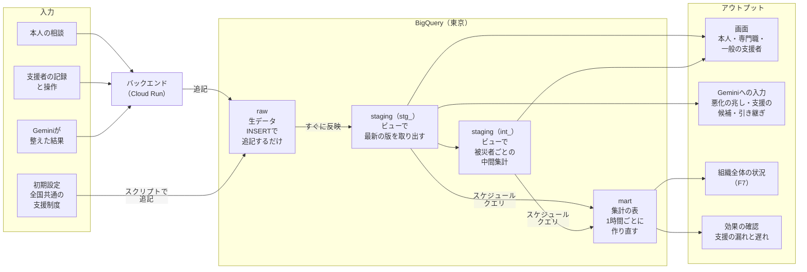

- **raw**：データセット`gdgoc_raw`。1つの出来事を1行として、発生したまま追記する。上書きと削除はしない（誰がいつ何を変えたか追えるようにするため）。
- **staging**：データセット`gdgoc_staging`。すべてビューで作るため、rawに書き込んだ内容がすぐに反映される。`stg_`のビューでrawから最新の版を取り出して整え、`int_`のビューで被災者ごとの中間集計を作る。
- **mart**：データセット`gdgoc_mart`。スケジュールクエリで1時間ごとに、stagingから作り直す表である。

表とビューのつながりは、次の2つの図のとおりである。

**図1：rawからstaging（stg_）まで**

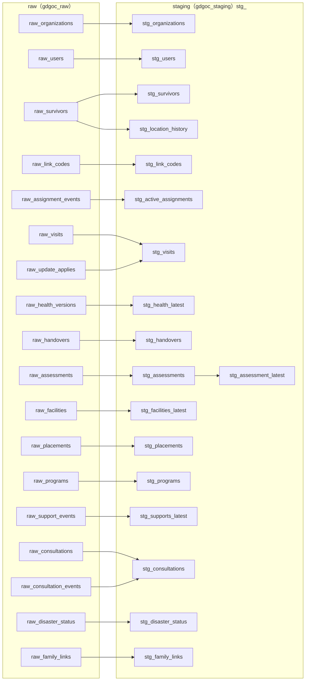

**図2：staging（stg_）から中間集計（int_）・mart・アウトプットまで**

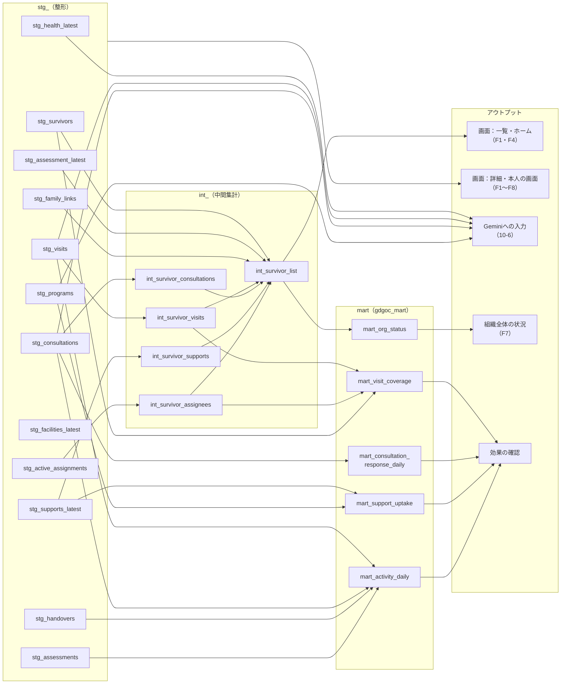

- 図2の「stg_（整形）」の枠から「画面：詳細・本人の画面」への矢印は、詳細の画面がstg_の各ビューから、その人の記録を読むことを表す。
- 図2では、stg_のビューのうち中間集計・mart・Geminiへの入力に使わないもの（stg_organizations・stg_users・stg_location_history・stg_link_codes・stg_placements・stg_disaster_status）を省いている。これらはバックエンドが権限の確認や詳細の画面・周りの地域の状況（F10）のために直接読む。
- 相談のやり取り（返事と本人の書き足し）は、stg_consultationsが最新の返事しか持たないため、バックエンドがraw_consultation_eventsを相談のIDで直接読む。家族の招待コードの照合も、raw_link_codesを発行から7日の範囲で直接読む。

#### 7-3-1. raw（生データ）の表とカラム

rawの表は18個ある。表の定義は[03_sql/02_raw_tables.sql](../03_sql/02_raw_tables.sql)が正本で、開発中に足した列は`03_sql/06〜10_migrations.sql`（`ALTER TABLE … ADD COLUMN IF NOT EXISTS`）で、すでにある環境にも足せる。

すべての表に、次の共通のカラムを持たせる。被災者に関わる表には、`survivor_id`も持たせる。

| カラム | 型 | 内容 |
|---|---|---|
| event_id | STRING | 出来事のID（UUID） |
| org_id | STRING | 組織のID（組織のない利用者・本人の行と、公開の相談への返事は空の文字列） |
| created_at | TIMESTAMP | 発生日時 |
| created_by | STRING | 操作した利用者のID（初期設定のスクリプトは`system`） |
| created_role | STRING | 操作した人の立場（`survivor`・`professional`・`volunteer`・`facility_staff`・`system`） |
| survivor_id | STRING | 被災者のID（被災者に関わる表だけ） |

以下は、共通のカラムのほかに持たせるカラムである。

**raw_organizations**（組織。アプリの「組織を作る」で登録。参加コードを発行し直すたびに1行）

| カラム | 型 | 内容 |
|---|---|---|
| org_name | STRING | 組織の名前（例：市町の名前） |
| prefecture | STRING | 都道府県 |
| municipality_code | STRING | 受け持つ市区町村の団体コード（6桁） |
| pro_join_code_hash・vol_join_code_hash | STRING | 専門職用・一般の支援者用の参加コードのハッシュ（ソルト付きSHA-256） |
| pro_join_code・vol_join_code | STRING | 参加コードの元の値（オーナーに何回でも見せるため。APIはオーナーにだけ返す） |

**raw_users**（利用者の登録と変更。変えるたびに1行。F0）

| カラム | 型 | 内容 |
|---|---|---|
| user_id | STRING | 利用者のID（Firebase Authenticationのuid） |
| role | STRING | 立場（`survivor`・`professional`・`volunteer`・`facility_staff`） |
| profession | STRING | 職種（保健師・ケアマネジャー・相談員・その他。専門職だけ。「該当なし」は空） |
| display_name | STRING | 表示名 |
| login_method | STRING | 最初のログインの方法（`google`・`phone`）。電話番号そのものは保存しない |
| linked_survivor_id | STRING | 本人の場合、自分の被災者の記録のID |
| contact | STRING | 支援者の連絡先（電話番号など） |
| municipality_code | STRING | 支援者が活動する市区町村の団体コード |
| address | STRING | 支援者の住所（本人にだけ見せる） |
| org_permission | STRING | 組織の中の権限（`owner` か空） |
| facility_id | STRING | 施設の職員の場合、自分の施設のID |

**raw_survivors**（被災者の記録の版。基本の情報・段階・居場所が変わるたびに1行。F1）

| カラム | 型 | 内容 |
|---|---|---|
| version | INT64 | 版の番号（1から増える） |
| full_name | STRING | 氏名 |
| age | INT64 | 年齢 |
| household_size | INT64 | 世帯の人数 |
| contact | STRING | 連絡先（任意） |
| stage | STRING | 段階（`evacuation`＝③・`temporary`＝④・`rebuilding`＝⑤） |
| location_type | STRING | 居場所の種類（避難所・福祉避難所・自宅・車中泊・親せき知人の家・2次避難先・病院・介護施設・建設型仮設・賃貸型仮設・恒久住宅） |
| location_detail | STRING | 具体的な場所（避難所名・施設名・地区など） |
| self_user_id | STRING | 本人の利用者ID（本人とつながるまでは空） |
| registered_via | STRING | 誰が作ったか（`professional`・`self`・`proxy`＝家族などが代わりに登録） |
| municipality_code | STRING | 住んでいる市区町村の団体コード（6桁） |
| address | STRING | 住所（町名・番地など。任意） |
| proxy_consent | STRING | 代わりの登録での本人の同意（`obtained`＝同意を得た・`unable`＝同意できない状態。`proxy` のときだけ） |

**raw_link_codes**（確認コードの発行と使用。F0・F1）

| カラム | 型 | 内容 |
|---|---|---|
| code_hash | STRING | 確認コードのハッシュ |
| action | STRING | `issued`（発行）・`used`（使用）・`failed`（入力の誤り）。家族の招待コードは `family_issued`・`family_used` |
| expires_at | TIMESTAMP | 有効期限（発行から7日） |

**raw_assignment_events**（担当の割り当て。F1）

| カラム | 型 | 内容 |
|---|---|---|
| assignment_id | STRING | 割り当てのID |
| supporter_user_id | STRING | 担当になる一般の支援者のID |
| action | STRING | `assigned`（割り当て）・`approved`（本人の承認）・`verbal_consent`（口頭の同意の記録）・`removed`（外す） |

**raw_visits**（訪問・見守りの記録。直すときは同じvisit_idで版を足す。F2）

| カラム | 型 | 内容 |
|---|---|---|
| visit_id | STRING | 記録のID |
| version | INT64 | 版の番号 |
| visited_at | TIMESTAMP | 訪問した日時 |
| raw_text | STRING | 入力した文章 |
| location・condition・meal・sleep・medication・environment・concerns・change・next_action | STRING | 整えた9つの項目（今の居場所・体調・食事・睡眠・服薬・生活の環境・困りごと・前回からの変化・次に必要な対応）。書かれていない項目は「記載なし」 |
| location_proposal | JSON | 居場所の更新の案 |
| health_proposal | JSON | 健康・介護の更新の案 |
| proposal_status | STRING | 更新の案の状況（`none`・`applied`・`pending`） |
| ai_used | BOOL | Geminiで整えたか（`false`は手入力） |

**raw_update_applies**（確認待ちの更新の案を、専門職が反映した記録。F2）

| カラム | 型 | 内容 |
|---|---|---|
| visit_id | STRING | 元の記録のID |
| applied_items | ARRAY&lt;STRING&gt; | 反映した内容（`location`・`health`） |
| result | STRING | `applied`（反映した）・`rejected`（反映しない） |

**raw_health_versions**（健康・介護の情報の版。F3）

| カラム | 型 | 内容 |
|---|---|---|
| version | INT64 | 版の番号 |
| chronic_diseases | ARRAY&lt;STRING&gt; | 持病 |
| medications | ARRAY&lt;STRING&gt; | 飲んでいる薬 |
| allergies | STRING | アレルギー |
| primary_clinic | STRING | かかりつけの医療機関 |
| medical_needs | ARRAY&lt;STRING&gt; | 必要な医療（透析・在宅酸素・たんの吸引など） |
| care_level | STRING | 要介護度 |
| assistance_mobility・assistance_meal・assistance_toilet | STRING | 移動・食事・排せつで必要な介助 |
| dementia_notes | STRING | 認知症の有無と配慮すること |
| family_contact | STRING | 連絡してほしい家族など |
| source | STRING | 誰の情報か（`professional`・`self`＝本人の申告・`visit_proposal`＝訪問記録の案から） |

**raw_handovers**（引き継ぎシート。F3）

| カラム | 型 | 内容 |
|---|---|---|
| handover_id | STRING | 引き継ぎシートのID |
| destination | STRING | 移る先 |
| health_version | INT64 | 載せた健康・介護の情報の版 |
| summary | STRING | 直近の記録と相談の要約 |
| cautions | STRING | 気をつけること |
| ai_used | BOOL | Geminiで要約を作ったか |

**raw_assessments**（悪化の兆しの判断。F4）

| カラム | 型 | 内容 |
|---|---|---|
| assessment_id | STRING | 判断のID |
| level | STRING | 度合い（`high`・`medium`・`low`） |
| evidence | JSON | 根拠（記録や相談の記述と、その記録・相談のID） |
| next_action | STRING | 次に必要な対応 |
| source | STRING | `ai`（Geminiの判断）・`professional`（専門職が変えた） |
| override_reason | STRING | 専門職が変えた理由 |
| trigger_id | STRING | 判断のきっかけになった記録か相談のID |

**raw_facilities**（施設の登録と更新。F5）

| カラム | 型 | 内容 |
|---|---|---|
| facility_id | STRING | 施設のID |
| version | INT64 | 版の番号 |
| facility_name | STRING | 施設の名前 |
| facility_type | STRING | 種類（福祉避難所・介護施設・病院など） |
| address | STRING | 場所 |
| vacancies | INT64 | 空きの数 |
| capabilities | ARRAY&lt;STRING&gt; | 対応できる介護・医療（透析・たんの吸引・認知症・車いすなど） |
| water_outage・power_outage | BOOL | 断水・停電しているか |
| staff_join_code_hash・staff_join_code | STRING | 施設の職員用の参加コードのハッシュと元の値（元の値はその組織の専門職にだけ返す） |
| change_kind | STRING | 版を足した理由（`info`＝空きなど・`join_code`＝参加コードの発行だけ）。最終更新の時刻は `info` の版だけで決める |

**raw_placements**（移る先の決定。F5）

| カラム | 型 | 内容 |
|---|---|---|
| placement_id | STRING | 決定のID |
| candidates | JSON | ルールで出した候補の施設のIDと理由（最大3件） |
| chosen_facility_id | STRING | 選んだ施設のID |
| chosen_from_candidates | BOOL | 候補から選んだか |
| chosen_reason | STRING | 選んだ理由 |

**raw_programs**（支援制度の情報。初期設定で登録。`org_id` が空の行は全国共通の制度）

| カラム | 型 | 内容 |
|---|---|---|
| program_id | STRING | 制度のID |
| version | INT64 | 版の番号 |
| program_name | STRING | 制度の名前 |
| conditions | STRING | 対象になる条件 |
| benefit | STRING | 受けられる内容（金額など） |
| apply_to | STRING | 申請先 |
| deadline_rule | STRING | 申請の期限の決まり |
| documents | STRING | 必要な書類 |
| source_url | STRING | 出典 |

**raw_support_events**（示した支援と、申請の状況の変更。F6）

| カラム | 型 | 内容 |
|---|---|---|
| support_id | STRING | 支援の記録のID（被災者と制度の組み合わせごと） |
| program_id | STRING | 制度のID |
| action | STRING | `suggested`（Geminiが示した）・`status_changed`（状況を変えた） |
| reason | STRING | 受けられそうな理由（示したとき） |
| status | STRING | 申請の状況（`not_applied`・`applying`・`received`・`not_eligible`） |
| deadline | DATE | 申請の期限 |
| housing_damage・rebuild_intent | STRING | 示したときの住宅の被害の程度・再建の方法の意向 |

**raw_consultations**（本人からの相談。F8）

| カラム | 型 | 内容 |
|---|---|---|
| consultation_id | STRING | 相談のID |
| raw_text | STRING | 本人が書いた文章 |
| category | STRING | 相談の種類（体調・介護・住まい・お金と制度・生活・その他） |
| structured | JSON | F2と同じ9つの項目に整えた内容 |
| emergency_flag | BOOL | 急を要するとAIが判断したか（119番などの案内を出したか） |
| urgency | STRING | 急ぎの度合い（`high`・`medium`・`low`） |
| urgency_evidence | STRING | 急ぎの度合いの根拠 |
| ai_used | BOOL | Geminiで整えたか |

**raw_consultation_events**（相談への返事・本人の書き足し・状況の変更。F8）

| カラム | 型 | 内容 |
|---|---|---|
| consultation_id | STRING | 相談のID |
| action | STRING | `replied`（専門職の返事）・`message`（本人の書き足し）・`status_changed`（状況を変えた） |
| reply_text | STRING | 返事・書き足しの文章 |
| next_action | STRING | 次の対応 |
| status | STRING | 相談の状況（`open`・`in_progress`・`closed`） |

**raw_disaster_status**（周りの地域の状況。F10。被災者に関わらないので `survivor_id` は持たない）

専門職（組織のオーナーを含む）が、公開の情報を出典のURLつきで入れる。直すときも、終わった・取り下げたときも版を足す（消さない）。

| カラム | 型 | 内容 |
|---|---|---|
| status_id | STRING | 状況の1件のID（版をまたいで同じ） |
| version | INT64 | 版の番号 |
| municipality_code・prefecture_code | STRING | 市区町村の団体コード（6桁）と、都道府県の番号（団体コードの上2桁） |
| disaster_name | STRING | 災害の名前 |
| item_kind | STRING | 項目（`relief_act` 災害救助法の適用・`support_act` 被災者生活再建支援法の適用・`support_open` 受付中の支援・`shelter` 避難所・`temporary_housing` 仮設住宅・`other` その他） |
| state | STRING | 状態（適用中・開設中など） |
| ended | BOOL | 終わった・取り下げたか |
| deadline | DATE | 申請・受付の期限（ないときは空） |
| source_url | STRING | 出典のURL（必須。http か https） |
| note | STRING | 補足 |

**raw_family_links**（家族と記録のつながり。F9）

| カラム | 型 | 内容 |
|---|---|---|
| user_id | STRING | 家族としてつながる利用者のID（一般の支援者） |
| action | STRING | `link`（つなぐ）・`unlink`（外す） |
| via | STRING | つながり方（`proxy`＝代わりに登録した・`invite`＝本人の招待コード） |

#### 7-3-2. staging（整形）のビュー

`stg_`のビューは、rawから最新の版を取り出すか、すべての行の型をそろえて整える。最新の版は、IDごとに`version`（版のない表は`created_at`）の大きい1行を`ROW_NUMBER()`で取り出す。

| ビュー | 元の表 | 1行の単位 | 主なカラムと作り方 |
|---|---|---|---|
| stg_organizations | raw_organizations | 組織 | org_idごとの最新の1行。org_name・prefecture・municipality_code・参加コードのハッシュと元の値（F0の参加コードの確認とオーナーへの表示に使う） |
| stg_users | raw_users | 利用者 | user_idごとの最新の1行。user_id・org_id・role・profession・display_name・linked_survivor_id・contact・municipality_code・address・org_permission・facility_id。要求のたびに、立場と組織をここから決める |
| stg_survivors | raw_survivors | 被災者 | survivor_idごとの最新の版。基本の情報・stage・location_type・location_detail・self_user_id。最初の版のcreated_atをregistered_at、最新の版のcreated_atをupdated_atとする |
| stg_location_history | raw_survivors | 居場所・段階の変更 | 前の版とstageかlocation_typeが違う版だけを残す（`LAG()`で前の版と比べる）。changed_at・stage・location_type・前の居場所 |
| stg_link_codes | raw_link_codes | 確認コード | code_hashごとに発行・使用・誤りの出来事をまとめる。使われておらず期限内のものをis_valid=true、直近1時間の誤りの回数をfailed_count_1hとする（F0・F1の確認コードの確認に使う） |
| stg_active_assignments | raw_assignment_events | 有効な担当 | assignment_idごとに出来事を並べ、承認（approvedかverbal_consent）があり、その後にremovedがないものだけを残す。survivor_id・supporter_user_id・consented_at・consent_type |
| stg_visits | raw_visits・raw_update_applies | 訪問・見守りの記録 | visit_idごとの最新の版。proposal_statusがpendingで、raw_update_appliesに反映の記録がないものをis_pending=trueとする |
| stg_health_latest | raw_health_versions | 被災者 | survivor_idごとの最新の版。健康・介護の項目とsource |
| stg_handovers | raw_handovers | 引き継ぎシート | すべての引き継ぎシートを整える。survivor_id・destination・summary・cautions・created_at・ai_used |
| stg_assessments | raw_assessments | 判断 | すべての判断を整える。level・evidence・source（AIの判断か専門職が変えたか）・override_reason・trigger_id・assessed_at |
| stg_assessment_latest | stg_assessments | 被災者 | survivor_idごとの最新の判断。level・evidence・source・assessed_at |
| stg_facilities_latest | raw_facilities | 施設 | facility_idごとの最新の版。最終更新（`info`の版の時刻）から24時間以上たったものをis_stale=trueとする。最後に空きなどを更新した人の立場（updated_role）と、施設の参加コードを持つ |
| stg_placements | raw_placements | 移る先の決定 | すべての決定を整える。候補・選んだ施設・候補から選んだか・選んだ理由 |
| stg_programs | raw_programs | 制度 | program_idごとの最新の版 |
| stg_supports_latest | raw_support_events | 被災者と制度の組み合わせ | support_idごとの最新の状況。最初にsuggestedしたときの理由と日時、今のstatus、deadline、期限までの日数（`DATE_DIFF(deadline, CURRENT_DATE(), DAY)`） |
| stg_consultations | raw_consultations・raw_consultation_events | 相談 | 相談の本体に、最新のstatus、最初の返事の日時（repliedのcreated_atの最小）、最新の返事を結合する。返事がなくstatusがopenのものを未対応とする |
| stg_disaster_status | raw_disaster_status | 周りの地域の状況 | status_idごとの最新の版。最新の版のcreated_atをupdated_atとする。終わったもの（ended）も残し、画面に出すかはバックエンドが決める。更新から30日を超えたかもバックエンドが決める |
| stg_family_links | raw_family_links | 記録と家族の組 | 記録と利用者の組ごとの最新の行が`link`のもの（いまつながっている家族）。survivor_id・user_id・via・linked_at |

#### 7-3-3. staging（中間集計）のビュー

`int_`のビューは、`stg_`のビューを被災者ごとにまとめた中間集計である。一覧・ホームの表示とmartの両方で使う。

| ビュー | 元のビュー | 1行の単位 | カラムと作り方 |
|---|---|---|---|
| int_survivor_visits | stg_visits | 被災者 | last_visited_at（visited_atの最大）、days_since_last_visit（今日との日数の差）、visits_30d（30日以内の記録の数）、pending_proposals（is_pending=trueの数） |
| int_survivor_consultations | stg_consultations | 被災者 | open_consultations（未対応の数）、max_open_urgency（未対応の中で一番高い急ぎの度合い）、last_consulted_at（最後に相談した日時） |
| int_survivor_supports | stg_supports_latest | 被災者 | suggested_count（示した制度の数）、unapplied_count（not_appliedの数）、nearest_unapplied_deadline（未申請の中で一番近い期限）、days_to_nearest_deadline |
| int_survivor_assignees | stg_active_assignments | 被災者 | assignee_user_ids（有効な担当のIDの一覧）、assignee_count |
| int_survivor_list | stg_survivors・stg_assessment_latest・上の4つのビュー・stg_family_links | 被災者 | 一覧とホームに使う。基本の情報・段階・居場所に、悪化の兆しの度合いと上の中間集計を結合する。家族の利用者のID（family_user_ids。家族として見てよいかの判定に使う）も入れる。並べ替えの順は、悪化の兆しの度合い（高→低）、未対応の相談の急ぎの度合い（高→低）、最後の訪問からの日数（長い順）とする |

#### 7-3-4. mart（集計）の表

スケジュールクエリで1時間ごとに`CREATE OR REPLACE TABLE`で作り直す。どの表にも、作り直した日時（as_of）と組織のID（org_id）を持たせる。

| 表 | 元のビュー | 1行の単位 | カラムと作り方 | 使うところ |
|---|---|---|---|---|
| mart_org_status | int_survivor_list | 組織・段階・居場所の種類・悪化の兆しの度合い | survivor_count（人数）、with_open_consultation（未対応の相談がある人数）、with_unapplied_support（未申請の支援がある人数）、with_pending_proposal（反映待ちの更新の案がある人数） | F7 |
| mart_visit_coverage | int_survivor_visits・int_survivor_assignees・stg_survivors | 組織・段階 | survivor_count、not_visited_7d（最後の訪問から7日以上たった人数。日数は設定で変える）、not_visited_7d_rate（その割合）、with_volunteer（一般の支援者の担当がいる人数）、with_volunteer_rate（その割合） | 効果の確認（見守りが行き届いているか） |
| mart_consultation_response_daily | stg_consultations | 組織・相談を受けた日・相談の種類 | consultation_count（相談の数）、replied_count（返事をした数）、median_first_reply_minutes（最初の返事までの時間の中央値）、p90_first_reply_minutes（90%の相談に返事をするまでの時間）、open_count（未対応の数） | 効果の確認（相談員に届くまでの遅れ） |
| mart_support_uptake | stg_supports_latest・stg_programs | 組織・制度 | suggested_count（示した数）、applied_count（applyingとreceivedの数）、received_count、unapplied_past_deadline（期限を過ぎて未申請の数）、uptake_rate（applied_count ÷ suggested_count） | 効果の確認（支援の漏れ） |
| mart_activity_daily | stg_visits・stg_consultations・stg_handovers・stg_assessments | 組織・日・立場 | visit_count（訪問・見守りの記録の数）、consultation_count、handover_count（引き継ぎシートの数）、ai_used_rate（Geminiで整えた記録の割合）、ai_override_count（AIの判断を専門職が変えた数） | 効果の確認（記録の量と、人がAIの判断を見直している度合い） |

#### 7-3-5. アウトプット

- **画面**：バックエンドが`stg_`と`int_`のビューから読み、立場と担当に応じた範囲だけを返す（10-3）。書いた内容は、すぐに画面に出る。
- **Geminiへの入力**：バックエンドが`stg_`のビューから、その人の直近の記録・相談・健康と介護の情報と、支援制度の情報を読んで渡す（10-6）。施設の候補（F5）は、`stg_facilities_latest`からバックエンドがルールで並べる。
- **組織全体の状況（F7）**：`mart_org_status`から読む。
- **効果の確認**：`mart_visit_coverage`・`mart_consultation_response_daily`・`mart_support_uptake`・`mart_activity_daily`で、見守りの行き届き方・相談への返事の早さ・支援の受け取り方・記録の量を確かめる。

---

## 8. ユーザーフロー

立場ごとに、利用者が行う操作の流れを示す。どの立場も、② 発災直後の後、③ 避難生活に入ってから使い始める。

### 8-1. 被災者本人のフロー

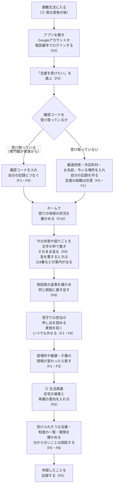

- 自分の記録だけを見られる。支援者が書いた訪問・見守りの記録の本文と、悪化の兆しの度合い・相談の急ぎの度合いは表示されない。
- 支援の組織につながっていなくても、相談（公開の相談になる）・健康と介護の情報・受けられる支援（全国共通の制度）を使える。あとからプロフィールで組織をつなげる。

### 8-2. 支援者（専門職）のフロー

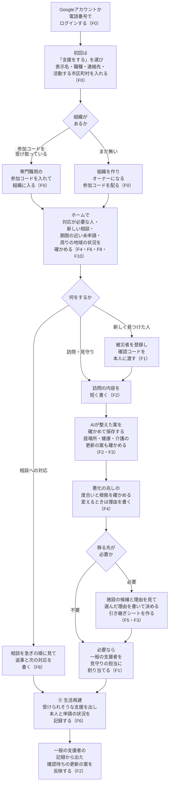

- 所属する組織の被災者すべての記録を扱える。組織につながっていない本人の公開の相談にも返事を書ける。
- 施設を登録したら、施設の職員用の参加コードを施設に渡す（F5）。周りの地域の状況を、出典つきで入れる（F10）。

### 8-3. 支援者（一般）のフロー

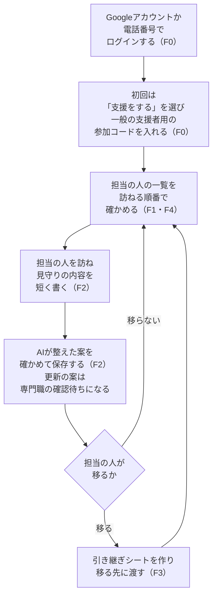

- 担当になった人（本人が認めた人、または専門職が口頭の同意を記録した人）の記録だけを扱える。担当を外れると見られなくなる。
- 参加コードを持っていない人も登録できる。組織に入るまでは被災者の記録を見られず、公開の相談を読む・家族の機能（8-5）・周りの地域の状況を使える。

### 8-4. 施設の職員のフロー

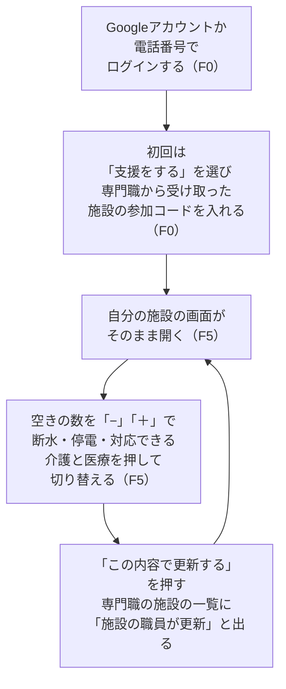

- 自分の施設だけを扱える。被災者の記録は見られない。

### 8-5. 家族のフロー

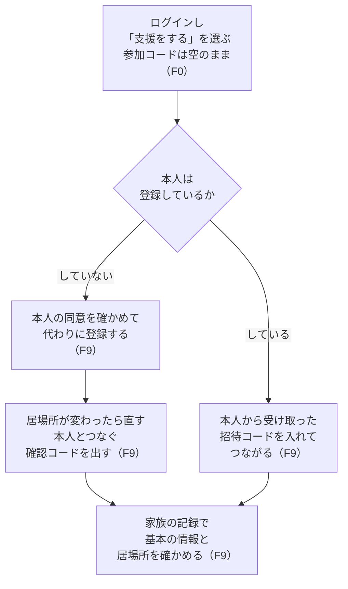

- 家族として見られるのは、基本の情報と居場所だけである。健康・介護の情報・相談・訪問の記録は見られない。本人はいつでも家族を外せる。

### 8-6. デモの流れ

次の3人を例に、③から⑤までを1つの記録でつなぐ。これは流れの例であり、デモでは氏名や健康の状態などをその場で画面から入力して確かめる。

- **田中さん**：82歳、夫と2人暮らし、糖尿病、要介護2。自分では登録しないため、保健師が登録する。
- **山本さん**：被災しなかった地域から来たボランティア（一般の支援者）。田中さんの見守りの担当になる。
- **佐藤さん**：45歳、自宅が全壊し賃貸型の仮設住宅で暮らす。ケアマネジャーなどの専門職はついていない。電話番号でログインし、自分で相談する。

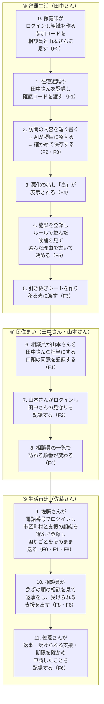

- 手順2・3・4・5・6・10・11で、支援者や本人がAIの出力やルールの候補を確かめて決める。ここで止まると後の手順は進まない。手順9で本人が送る相談は、AIで整えずにそのまま届く。
- 手順0から11まで、開発者の手作業なしで進められること（審査基準 2-a）。事前に登録しておくのは、全国共通の支援制度の情報だけとする（組織は手順0でアプリの中で作る）。被災者・施設・記録は、手順の中で画面から入力する。
- デモでは、保健師・相談員（専門職）、山本さん（一般の支援者）、佐藤さん（被災者本人）のアカウントを使い、立場ごとに見える画面が違うことも示す。時間があれば、施設の職員が空きを更新する場面（8-4）と、家族が代わりに登録する場面（8-5）も示す。

---

## 9. システムフロー

1. ログインを確かめ、利用者の立場と所属する組織（施設の職員は施設も）を、要求のたびにBigQueryから読み直して特定する。以降は、立場と担当に応じた範囲のデータだけを扱う（F0）。
2. 組織のない支援者が組織を作り、参加コードを発行する。参加コードを入れた支援者を、その組織の専門職・一般の支援者・施設の職員にする（F0）。
3. 専門職・本人・家族が被災者の記録を作り、居場所と段階を記録する。専門職と家族が作ったときは確認コードを発行する（F1・F9）。
4. 専門職が一般の支援者を担当に割り当て、本人の承認（または口頭の同意の記録）を受けて有効にする（F1）。
5. 訪問・見守りの文章を受け取り、Gemini APIで項目に整えて返す。書いた人の確認を受けて保存する（F2）。
6. 記録の中の居場所・健康・介護の変化を見つけ、更新の案を示す。専門職の確認を受けて反映する（F1・F3）。
7. 本人の相談をそのまま受け取り、Gemini APIの1回の問い合わせで種類・項目・急を要するか・急ぎの度合いを付けて保存する。組織があればその組織の専門職に、なければ公開の相談として支援者全員に、急ぎの順で表示する（F8）。
8. 組織のある人の記録と相談を保存したら、応答を返す前にGemini APIで悪化の兆しの度合いと根拠を出し、一覧の順番に反映する（F4）。
9. 移る先が必要なとき、健康・介護の情報と施設の情報から、ルールで候補と理由を出す。専門職の決定を記録する（F5）。施設の空きは、施設の職員か専門職が更新する。
10. 移る先が決まったら、Gemini APIで引き継ぎシートの要約を作り、作った人の確認を受けて保存し、記録を見られる人に表示する（F3）。
11. 住宅の被害・世帯・再建の意向・直近の相談と支援制度の情報から、Gemini APIで受けられそうな支援を出す。申請の状況を記録し、期限の近いものを本人と専門職に知らせる（F6）。
12. 専門職が入れた周りの地域の状況を、利用者の市区町村と同じ県で絞って表示する（F10）。
13. BigQueryのスケジュールクエリが、1時間ごとにmartの集計を作り直す（F7）。
14. すべての要求について、いつ・誰が・どの処理をしたか、かかった時間、エラーの種類を記録する（本文や個人の情報は記録しない）。

---

## 10. アーキテクチャ

練習で動いた構成（Cloud Run・FastAPI・Firebase Authentication）を土台にした。データは練習と同じBigQueryにraw・staging・martの3層で置き（7-3）、GeminiはGoogle AI StudioのAPIキー（無料枠）で呼ぶ。提出用のアーキテクチャ図は、この章をもとにGoogle Cloudの公式アイコンで描いた（[images/gcp_architecture.svg](images/gcp_architecture.svg)。READMEに載せている）。

### 10-1. 全体の構成

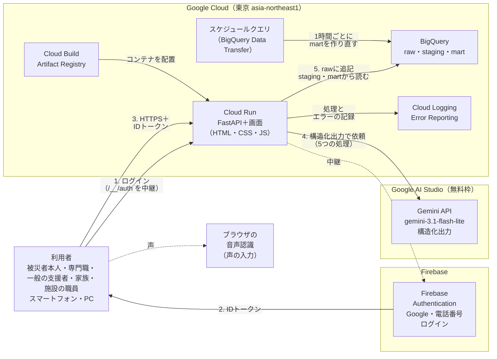

- 利用者のブラウザは、本アプリのデータについてはCloud Runとだけ通信する。BigQueryとGemini APIには、ブラウザから直接つながない。
- ログインはFirebase AuthenticationのJavaScript SDK（v13。gstatic.comから読む）で行う。iPhoneのSafariでログインできるよう、authDomainをアプリのドメインにし、Cloud Runが`/__/auth/*`をFirebaseへ中継する。本番はリダイレクト方式でログインする。
- Cloud Runは、IDトークンをGoogleの公開鍵で確かめ、利用者の立場と組織をBigQueryの`stg_users`から読み直す。
- 画面は1つのアプリ（ビルドしないHTML・CSS・JavaScript）で、立場ごとに表示を切り替える。Cloud Runが同じドメインで配る。市区町村の一覧（総務省の全国地方公共団体コード。47都道府県・1,747市区町村。基準日2024-01-01）は、JSONのファイルとして画面と一緒に配り、APIとBigQueryを使わない。
- 声の入力は、ブラウザに入っている音声認識（Web Speech API）を使う。声はブラウザの会社のサーバーで文字にされることがあり、本アプリのサーバーには届かない。
- Cloud Runは、別のURLで来た要求を決まったURL（環境変数`CANONICAL_HOST`）へ移す。

### 10-2. 採用する技術と理由

テーマのOwn the Whyに合わせ、比べた案と選ばなかった理由も書く（提出ドキュメントの「選定理由・メリット／デメリット」に使う）。

1. **実行基盤：Cloud Run（1サービス、東京）**
   - 理由：コンテナを置くだけで動き、要求が増えると台数を自動で増やす（コードを変えない）。要求がないときは0台になり、費用がかからない。リビジョンで前の版に戻せる。練習で同じ構成をデプロイ済みである。
   - 比べた案：GKE（開発の期間の中では運用の手間が大きい）、Cloud Run functions（関数が多数に分かれ、画面と一緒に管理しにくい）。
   - 設定：サービス名`gdgoc-app`、最小0台・最大3台、メモリ512MiB、要求のタイムアウト60秒。**CPUはリクエストを処理している間だけ割り当てる**（`--cpu-throttling`。その間だけ課金され、無料枠に収まる）。最大台数は設定だけで変えられる。入れ物は`python:3.12-slim`をもとに[Dockerfile](../Dockerfile)で作り、アプリ（`02_app`）だけを載せる。
   - 注意：最小0台のため、しばらくアクセスがないと、最初に開いた人は起動を数秒待つ。審査やデモの直前に一度開いておく。
   - 注意：CPUは応答の後に止まるため、悪化の兆しの判断（F4）は応答を返す前に終える（10-5の注）。
2. **バックエンド：Python 3.12＋FastAPI／フロントエンド：ビルド不要のHTML・CSS・JavaScript**
   - 理由：練習と同じで、開発の期間（11月5日〜11月10日）の中で作り切れる。画面はCloud Runから同じドメインで配る。
   - 比べた案：ReactやNext.js（ビルドと配る仕組みが増える）。
   - 主なライブラリ：FastAPI 0.162・uvicorn 0.54・google-genai 2.33・google-cloud-bigquery 3.46・google-auth 2.62・python-dotenv（[requirements.txt](../requirements.txt)で版を固定する）。画面は外部のライブラリを使わず、ES modulesで機能ごとのファイルに分ける。アイコンは線で描いたものをリポジトリに置く。
   - 画面の作り：スマートフォンを基準にし、PCの広い画面（1024px以上）では左の縦のメニューと複数の列の一覧にする。入力の欄には、HTMLの`required`から「必須」「任意」の印を自動で出す。
3. **データストア：BigQuery（東京）**
   - 理由：記録を上書きせず、すべての版を残す（7-1）ため、追記するだけのrawと、最新の版を取り出すstagingのビューの形が合う。組織全体の状況（F7）や効果の確認の集計も、同じ場所でSQLで作れる。練習でraw→staging→martの3層を作って動かしている。無料枠（毎月 保存10GiB・クエリ1TiB）に収まる。
   - 比べた案：Firestore（1件ずつの読み書きは速いが、集計と履歴の分析に別の仕組みが要る）、Cloud SQL（常に動かすため費用がかかる）。
   - 注意：1回の書き込みに1秒ほどかかる（練習では約1.3秒）。保存の後は、書いた内容をそのまま画面に返し、読み直しを待たせない。書き込みはINSERTだけにし、UPDATEとDELETEは使わない（同じ表を同時に書き換えるときの制限を避けるため）。
4. **AI：Gemini（Google AI StudioのAPIキー・無料枠、SDKは`google-genai`）**
   - 理由：無料枠があり、デモの回数なら料金がかからない。キーは、請求先アカウントをつないでいないプロジェクトで作る（つないだプロジェクトのキーは有料の扱いになる）。
   - 比べた案：Vertex AI経由（APIキーが要らずCloud Creditの対象になるが、Geminiに無料枠がなく、呼ぶたびに料金がかかる。2026-11-09に変更）。
   - 注意：無料枠では、送った内容がGoogleの製品の改善に使われる。そのため、デモでは架空の人物の情報だけを入れる（1-3・11-3）。1分あたり・1日あたりの回数に上限があり、超えると429が返る（やり直しても失敗したら手入力の欄を出す）。
   - モデル：`gemini-3.1-flash-lite`（無料枠の対象で、応答が速いもの。2026-11-09に決めた）。モデル名はコードに書かず、環境変数`GEMINI_MODEL`で切り替える。
   - 使い方：構造化出力（出力の形をスキーマで指定し、決まった項目のJSONで受け取る）を使う。呼び出しは`services/gemini.py`の`generate_structured`にまとめ、temperatureは0、打ち切りは30秒、429・5xx・タイムアウトのときは最大2回やり直す。クライアントは起動時に1回だけ作る。
   - 回数：1回の相談で呼ぶのは2回（整える処理と急ぎの度合いを1回にまとめた処理と、悪化の兆し）。施設の候補はAIをやめてルールで並べ、呼ぶ回数を減らした。
5. **認証：Firebase Authentication（Googleログイン・電話番号ログイン）**
   - 理由：Googleログインは練習で実装済みで、Google Cloudのプロジェクトにそのまま追加できる。電話番号ログイン（SMSで届く確認コードを入れる方法）も同じ仕組みで使えるため、Googleアカウントを持たない高齢者なども使える。
   - 注意：練習ではiPhoneのSafariでログインできなかった。その対策（authDomainをアプリのドメインにして`/__/auth/*`を中継し、本番はリダイレクト方式でログインする）を最初から入れる。
   - 注意：電話番号ログインはSMSの送信に費用がかかる。動作を確かめるときは、Firebaseに登録したテスト用の電話番号と確認コードも使える（SMSを送らない）。
   - ログインの方法のつなぎ：Googleと電話番号を1人の利用者につなげる（Firebaseのアカウントのリンク機能）。電話番号が登録のない別の利用者になっているときは、画面の中でその利用者を消してつなぎ直す。サーバーにはFirebaseの利用者を消す権限（`firebase-admin`）を持たせない。
6. **記録：Cloud Logging・Error Reporting**
   - 理由：Cloud Runの標準出力に1行1つのJSONで出すだけで集まる。例外はError Reportingにまとまり、いつ・どの処理で起きたかを確かめられる。
   - 記録する項目：時刻、処理の名前（`POST /api/survivors/{survivor_id}/visits`の形。実際のIDは出さない）、利用者のIDと立場、組織のID、かかった時間、エラーの種類。記録の本文・健康の情報・氏名・電話番号・IDトークン・ログインの中継の確認用のコードはログに出さない。
7. **デプロイ：`gcloud run deploy --source`**
   - Cloud Buildが[Dockerfile](../Dockerfile)からコンテナを作り、Artifact Registryに置いて、Cloud Runに配置する。環境変数は`GOOGLE_CLOUD_PROJECT`・`BQ_LOCATION`・`GEMINI_MODEL`・`GEMINI_API_KEY`・`FIREBASE_API_KEY`・`FIREBASE_AUTH_DOMAIN`・`FIREBASE_APP_ID`・`CANONICAL_HOST`の8つで、値は`.env`とCloud Runの環境変数にだけ置く。
8. **集計の作り直し：BigQueryのスケジュールクエリ（BigQuery Data Transfer Service）**
   - martの5つの表を1時間ごとに作り直す。登録・止めるのは`04_scripts/schedule_mart.py`で行う。
9. **使わないもの**
   - Secret Manager：秘密情報はGeminiのAPIキーだけで、Cloud Runの環境変数で渡す。環境変数はプロジェクトの閲覧権限を持つ人に見えるが、本番のプロジェクトのメンバーは開発の2人だけのため、この形にする。キーは`.env`にだけ書き、リポジトリにコミットしない。Firebaseのウェブ用の設定は、公開してよい値である。
   - Firestore：データはBigQueryにまとめる（上の3）。
   - Google Maps Platform：F7の地図に使う案だったが、地図を作らなかったため使っていない（5-5）。
   - Vertex AI：無料枠がないため使わない（上の4）。
   - 外部のライブラリ・CDN（画面）：Firebase AuthenticationのSDK以外は読み込まない。

### 10-3. 立場と担当によるデータの分け方

- BigQueryのデータセットは、Cloud Runのサービスアカウントだけが読み書きできるようにする。ブラウザからは直接つながない。
- すべての表に組織のIDを持たせる。バックエンドは、IDトークンから取り出した利用者のIDで`stg_users`を読み、立場と組織を決める。要求の中に書かれた組織のIDや立場は使わない。
- クエリは必ずパラメータ付きで書き、組織のIDで絞る。文字列をつないでSQLを作らない。
- 組織のない利用者は、組織のIDを空の文字列で持つ。空の組織のIDで絞って、ほかの人の記録が読めることがないようにする。記録を扱うAPIは「立場と組織の両方がある」ことを求め、組織のない支援者には403を返す。
- 被災者の記録を読み書きするたびに、バックエンドで次を確かめる（`shared.load_visible`）。
  - **被災者本人**：その記録の本人の利用者IDが、自分のIDと同じであること（`stg_survivors`）。組織がなくてもよい。
  - **専門職**：その記録の組織のIDが、自分の組織のIDと同じであること。
  - **一般の支援者**：組織のIDが同じで、その記録の今有効な担当に自分が入っていること（`stg_active_assignments`）。
  - **家族**：家族の機能のAPI（`/api/family/*`）でだけ、いまつながっている家族であること（`int_survivor_list.family_user_ids`）を確かめる。返すのは基本の情報と居場所だけで、ほかのAPIは家族というだけでは使えない。
  - **施設の職員**：被災者の記録は読み書きしない（記録のAPIは根元で403）。読み書きできるのは、`stg_users`の施設のIDが指す自分の施設だけで、施設のIDは要求から受け取らない。
- 立場ごとに、使えるAPIを分ける（10-5の「使える人」）。使えないAPIは403を返す。組織の参加コードを見る・発行し直す・オーナーを付けるAPIは、組織のオーナーだけが使える。
- 公開の相談は、組織を問わず支援者が読めるが、氏名・年齢・被災者のIDを返さない。返事を書けるのは専門職だけとする。誰に見せるかは、本人の記録の**いまの**組織で決める（rawは書き換えない）。
- 本人向けに返すデータからは、訪問・見守りの記録の本文と悪化の兆しの度合い・相談の急ぎの度合いを、バックエンドで取り除く。
- 見る権限のない記録を指定されたときは、存在しないときと同じ404を返す（記録があるかどうかも分からないようにする）。
- 確認コード・招待コード・参加コードは、ソルト付きのハッシュにして保存する。確認コードと招待コードは有効を7日とし、1回使ったら無効にし、1時間に5回間違えたら入力できないようにする。参加コードの元の値は、オーナー（施設の参加コードはその組織の専門職）にだけ返す。
- APIを足したら、立場の表（[05_tests/test_permissions.py](../05_tests/test_permissions.py)の`PERMISSIONS`）に書くまで自動テストが通らないようにする。
- 次のことを、自動テストで確かめる：本人がほかの人の記録を読めない／一般の支援者が担当でない人や担当を外れた人の記録を読めない／別の組織の記録を読めない／本人に悪化の兆しの度合いが返らない／組織のない支援者が記録を読めない／外された家族が記録を読めない／施設の職員が記録を読めない。

### 10-4. BigQueryのデータセットと表の作り方

- データセットは`gdgoc_raw`・`gdgoc_staging`・`gdgoc_mart`の3つとし、東京（asia-northeast1）に作る。表とビューの一覧は7-3に書く。
- rawの表には、出来事のID（UUID）・組織のID・発生日時・操作した利用者のID・その立場を共通の列として持たせる。版を持つものには版の番号を持たせる。
- rawの表は発生日時の日付で分割し、組織のIDと被災者のIDでクラスタ化する（読む量を減らし、費用を抑えるため）。
- rawへの書き込みは、パラメータ付きのDMLのINSERTで行う（練習と同じ。ストリーミング挿入は無料枠の外のため使わない）。UPDATEとDELETEは使わない。
- stagingのビューは、被災者ごと・項目ごとに発生日時の新しい1行を取り出す（`ROW_NUMBER()`）。
- martは、スケジュールクエリで1時間ごとに作り直す（`CREATE OR REPLACE TABLE`）。
- 表とビューを作るSQLは[03_sql](../03_sql)に番号の順に置き、`04_scripts/run_sql.py`で順に実行する（01データセット→02 raw→03 stg→04 int→05 mart→06〜10 列の追加）。列を足すときは、新しい番号の`migrations`のSQLを足す。
- 初期設定として、全国共通の支援制度の情報（出典のある公的な情報。8件）を`04_scripts/seed.py`でrawに登録する。組織と参加コードは初期データに入れず、アプリの「組織を作る」で作る。被災者・施設・記録は、デモでも画面から入力する。
- デモの後は、`04_scripts/delete_data.py`でデータを消せる（`--rows-only`で表は残して中身だけを消す）。Firebaseの利用者は残る。

### 10-5. API

APIは69本ある。正本は[05_tests/test_permissions.py](../05_tests/test_permissions.py)の`PERMISSIONS`で、アプリが持つAPIがこの表と合っているかを自動テストで確かめる。

すべての要求に、`Authorization: Bearer <IDトークン>`を付ける（「なし」と書いたものを除く）。「AI」の列が○の処理は、Geminiを呼ぶ。そのうち「案」と書いたものは結果を返すだけで保存せず、保存は書いた人が確かめた後の別の要求で行う。「使える人」は、本＝被災者本人、専＝専門職、一＝一般の支援者（担当の人の記録だけ）、家＝家族（家族としてつながった一般の支援者）、施＝施設の職員（自分の施設だけ）、オ＝組織のオーナー、ロ＝ログインしていれば誰でも（初回の登録の前も）、登＝登録した人（見られる範囲は10-3で絞る）である。

| 機能 | メソッドとパス | 内容 | 使える人 | AI |
|---|---|---|---|---|
| ― | `GET /api/health` | 動作の確認（`/healthz`はCloud Runで予約されているため使わない） | なし | |
| F0 | `GET /api/public-config` | Firebaseのウェブ用の設定を返す（ログイン前。秘密情報はない） | なし | |
| F0 | `GET /api/organizations` | 組織の一覧（名前で探す） | ロ | |
| F0 | `GET /api/organizations/by-municipality` | 市区町村を受け持つ組織を探す | ロ | |
| F0 | `POST /api/onboarding/survivor` | 本人として登録する（市区町村と任意の組織で記録を作る、または確認コードで記録とつなぐ） | ロ | |
| F0 | `POST /api/onboarding/supporter` | 支援者として登録する（参加コードで専門職・一般・施設の職員と組織を決める。空なら組織のない一般の支援者） | ロ | |
| F0 | `GET /api/me` | 利用者の立場・組織・オーナーか・（本人なら）自分の記録のIDを返す | ロ | |
| F0 | `PATCH /api/me` | 支援者のプロフィール（表示名・職種・連絡先・活動する市区町村・住所）を直す | 専・一・施 | |
| F0 | `POST /api/me/join` | 組織のない支援者が参加コードで組織に入る | 一 | |
| F0 | `POST /api/me/organization` | 本人が支援の組織をつなぐ・変える・外す | 本 | |
| F0 | `POST /api/organizations` | 組織を作り、参加コードを発行する（作った人は専門職とオーナーになる） | 一（組織のない人） | |
| F0 | `GET`・`POST /api/organizations/join-codes` | 自分の組織の参加コードを見る・発行し直す | オ | |
| F0 | `GET /api/organizations/members` | 組織の専門職の一覧（オーナーを付けるため） | オ | |
| F0 | `POST /api/organizations/owners` | 専門職にオーナーの権限を付ける・外す（最後の1人は外せない） | オ | |
| F1 | `GET /api/survivors` | 被災者の一覧（訪ねる順番、絞り込み。一般の支援者は担当の人だけ）と、期限の近い未申請の知らせ | 専・一 | |
| F1 | `POST /api/survivors` | 被災者を登録し、確認コードを発行する（似た記録があれば知らせる） | 専 | |
| F1 | `GET /api/survivors/{id}` | 被災者の詳細（立場に応じた範囲を1画面分まとめて返す） | 登 | |
| F1 | `POST /api/survivors/{id}/location` | 居場所・段階を変える（履歴を残す） | 本・専 | |
| F1 | `PATCH /api/survivors/{id}/basic` | 基本の情報（氏名・年齢・世帯の人数・連絡先・住所）を直す（版を足す） | 本・専 | |
| F1 | `POST /api/survivors/{id}/assignments` | 一般の支援者を担当に割り当てる（口頭の同意の記録を含む） | 専 | |
| F1 | `POST /api/survivors/{id}/assignments/{aid}/approve` | 担当を認める | 本 | |
| F1 | `POST /api/survivors/{id}/assignments/{aid}/remove` | 担当を外す | 本・専 | |
| F2 | `POST /api/survivors/{id}/visits/structure` | 入力した文章を項目に整えた案と、居場所・健康の更新の案を返す | 専・一 | ○（案） |
| F2 | `POST /api/survivors/{id}/visits` | 確かめた記録を保存する（一般の支援者の更新の案は確認待ちにする）。続けて悪化の兆しを判断する | 専・一 | ○ |
| F2 | `POST /api/survivors/{id}/visits/{vid}/apply` | 確認待ちの更新の案を反映する・反映しない | 専 | |
| F3 | `PUT /api/survivors/{id}/health` | 健康・介護の情報を保存する（版を残す。本人なら本人の申告として残す） | 本・専 | |
| F3 | `GET /api/survivors/{id}/handovers` | 引き継ぎシートの一覧（その人の記録を見られる人） | 登 | |
| F3 | `POST /api/survivors/{id}/handovers/draft` | 引き継ぎシートの要約と気をつけることの案を返す | 専・一 | ○（案） |
| F3 | `POST /api/survivors/{id}/handovers` | 確かめた引き継ぎシートを保存する | 専・一 | |
| F4 | `PUT /api/survivors/{id}/assessment` | 度合いを変える（理由は必須） | 専 | |
| F5 | `GET`・`POST /api/facilities` | 施設の一覧・登録 | 専 | |
| F5 | `PATCH /api/facilities/{id}` | 空き・断水・停電・対応できる介護と医療の更新（版を足す） | 専 | |
| F5 | `GET`・`POST /api/facilities/{id}/staff-join-code` | 施設の参加コードを見る・発行し直す（前のコードは使えなくなる） | 専 | |
| F5 | `GET`・`PATCH /api/my-facility` | 自分の施設を読む・空き・断水・停電・対応できる介護と医療を直す（版を足す） | 施 | |
| F5 | `POST /api/survivors/{id}/facility-candidates` | 施設の候補を最大3件、理由とともに返す（ルールで並べる。AIは使わない） | 専 | |
| F5 | `POST /api/survivors/{id}/placements` | 移る先を決める（理由を残す） | 専 | |
| F6 | `GET /api/programs` | 見られる支援制度の一覧（全国共通と自分の組織の制度） | 本・専 | |
| F6 | `GET /api/survivors/{id}/supports` | その人に記録した支援と申請の状況の一覧 | 本・専 | |
| F6 | `POST /api/survivors/{id}/support-candidates` | 受けられそうな支援と理由・申請先・期限を返す | 本・専 | ○（案） |
| F6 | `POST /api/survivors/{id}/supports` | 支援を記録する（制度の一覧から記録するときは、住宅の被害の程度と意向を空にできる） | 本・専 | |
| F6 | `PATCH /api/survivors/{id}/supports/{sid}` | 申請の状況を更新する | 本・専 | |
| F7 | `GET /api/dashboard` | 組織全体の集計（いつ時点かを含む） | 専 | |
| F8 | `POST /api/survivors/{id}/consultations/structure` | 相談の文章を種類と項目に整えた案を返す（今の画面は使わない。古い画面のために残している。12章） | 本 | ○（案） |
| F8 | `POST /api/survivors/{id}/consultations` | 本人が書いた文章をそのまま送る。送ったときに整えた案と急ぎの度合い・根拠を付けて保存する（急を要するときは案内を返す）。組織があれば続けて悪化の兆しを判断する | 本 | ○ |
| F8 | `GET /api/consultations` | 組織の相談の一覧（未対応から、急ぎの順） | 専 | |
| F8 | `POST /api/survivors/{id}/consultations/{cid}/replies` | 返事と次の対応を書く | 専 | |
| F8 | `PATCH /api/survivors/{id}/consultations/{cid}` | 相談の状況を変える | 専 | |
| F8 | `GET /api/survivors/{id}/consultations/{cid}/messages` | 相談のやり取りを古い順に読む | 本・専 | |
| F8 | `POST /api/survivors/{id}/consultations/{cid}/messages` | 本人が同じ相談に書き足す | 本 | |
| F8 | `GET /api/consultations/public` | 公開の相談の一覧（氏名を出さない） | 専・一（組織がなくても） | |
| F8 | `GET /api/consultations/public/{cid}/messages` | 公開の相談のやり取り | 専・一 | |
| F8 | `POST /api/consultations/public/{cid}/replies` | 公開の相談に返事を書く（組織は問わない） | 専 | |
| F9 | `POST /api/family/survivors` | 本人の代わりに登録し、家族としてつながる | 一 | |
| F9 | `GET /api/family/survivors` | 家族としてつながっている記録の一覧 | 一 | |
| F9 | `GET /api/family/survivors/{id}` | 基本の情報・居場所・居場所の履歴を見る | 家 | |
| F9 | `PATCH /api/family/survivors/{id}/basic` | 基本の情報を直す | 家 | |
| F9 | `POST /api/family/survivors/{id}/location` | 居場所・段階を変える | 家 | |
| F9 | `POST /api/family/survivors/{id}/link-code` | 本人とつなぐ確認コードを出す（本人がつながる前だけ） | 家 | |
| F9 | `POST /api/family/join` | 本人の招待コードを入れて、家族としてつながる | 一 | |
| F9 | `POST /api/family/invites` | 家族の招待コードを出す | 本 | |
| F9 | `GET /api/family/members` | つながっている家族（表示名とつながり方だけ） | 本 | |
| F9 | `POST /api/family/members/{uid}/remove` | 家族を外す | 本 | |
| F10 | `GET /api/disaster-status` | 自分の市区町村と同じ県の状況（市区町村を指定しても見られる） | 本・専・一・施（組織がなくても） | |
| F10 | `POST /api/disaster-status` | 状況を入れる | 専 | |
| F10 | `PATCH /api/disaster-status/{id}` | 状況を直す・終わった印を付ける（入れた組織の専門職だけ） | 専 | |

- 悪化の兆しの判断（F4）は、F2の記録とF8の相談を保存した後、**応答を返す前に**バックエンドが続けて行う（Cloud Runは応答の後にCPUを止めるため、応答の後には走らせない）。判断が失敗しても、保存は成功のままにする。画面から呼ぶAPIにはしない（本人が相談を送ったときにも、本人に判断の結果を返さないため）。
- `/api`の外に、ログインの中継（`/__/auth/*`。Firebaseへそのまま中継する）と、画面のファイル（`/`）がある。

### 10-6. Geminiの処理

| 処理 | 渡すもの | 返させるもの（構造化出力） | 守らせること |
|---|---|---|---|
| 記録の整理（F2） | 入力した文章、今の居場所、今の健康・介護の情報 | 9つの項目、居場所の更新の案、健康・介護の更新の案 | 文章にない項目は「記載なし」にする。推測で埋めない |
| 相談の整理と急ぎの度合い（F8。送ったときに1回で行う） | 本人が書いた文章、本人が選んだ種類（あれば）、今の居場所、今の健康・介護の情報、直近の記録 | 相談の種類、F2と同じ9つの項目、急を要するかどうか、度合い（高・中・低）、根拠 | 文章にない項目は「記載なし」にする。急を要するかどうかと度合いは、迷ったら高いほうにする。急を要するときは度合いを高にする。根拠は相談の記述から引く。診断の言葉を使わない |
| 悪化の兆し（F4） | 直近の記録と相談（合わせて最大5件）、健康・介護の情報 | 度合い（高・中・低）、根拠（記録のどの記述か）、次に必要な対応 | 根拠は記録の記述から引く。診断の言葉を使わない |
| 引き継ぎシート（F3） | 健康・介護の情報、直近の記録、移る先 | 要約、気をつけること | 記録にないことを書かない |
| 受けられそうな支援（F6） | 住宅の被害の程度、世帯、再建の意向、直近の相談（90日・5件まで）、支援制度の一覧 | 制度のID、理由、申請先、期限、根拠にした相談のID | 渡した一覧にない制度・相談を出さない（返ったIDを一覧と照らして確かめる）。健康・介護のことを理由に書かない |

- 施設の候補（F5）は、Geminiを使わずルールで並べる（前は「施設の候補」もGeminiで出していた）。
- 指示文は処理ごとにファイルに分けて置き、コードと一緒に管理する（[02_app/backend/prompts](../02_app/backend/prompts)の`visit_structure.md`・`consultation_triage.md`・`risk_assessment.md`・`handover_draft.md`・`support_candidates.md`。古い画面のための`consultation_structure.md`も残している）。処理を足す・直すときは[.agents/skills/add-gemini-process/SKILL.md](../.agents/skills/add-gemini-process/SKILL.md)の手順に従う。
- Geminiが失敗したときは、記録・引き継ぎ・支援では画面に手入力の欄を出して続けられるようにし、相談は既定の値で保存する（5-4の8）。悪化の兆しは判断しないまま保存を成功にする。
- 自動テストではGeminiを呼ばず、差し替えて確かめる（無料枠の回数を使わないため）。

### 10-7. Google技術を使う理由（審査基準 1-b 用）

| Google技術 | 目的のどの部分を実現するか | 出力 | 使う機能 |
|---|---|---|---|
| Gemini API | 支援者が短く書いた記録を、引き継げる同じ項目にそろえる | 項目ごとに整えた訪問・見守りの記録 | 構造化出力 |
| Gemini API | 専門職がついていない人の相談を、急ぎの順に相談員へ届ける | 相談の種類・整えた内容・急ぎの度合いと根拠 | 構造化出力 |
| Gemini API | 悪化の兆しがある人に早く気づき、訪ねる順番を決めやすくする | 度合いと根拠 | 構造化出力 |
| Gemini API | 移る先に、持病や必要な介護と直近の様子を漏れなく引き継ぐ | 引き継ぎシートの要約と気をつけること | 構造化出力 |
| Gemini API | 受けられる支援を漏れなく伝える | 受けられそうな制度と理由・申請先・期限 | 構造化出力 |
| BigQuery | 被災者1人につき1つの記録を、版を消さずに③から⑤まで引き継ぐ。組織全体の状況と効果を集計する | 記録と履歴、集計 | ビュー、スケジュールクエリ（BigQuery Data Transfer Service） |
| Firebase Authentication | 被災者本人と支援者を識別し、立場と担当ごとに見られる範囲を分ける。Googleアカウントを持たない人も電話番号で使えるようにする | 利用者のID | Googleログイン、電話番号ログイン、アカウントのリンク |
| Cloud Run | 利用が増えても、コードを変えずに台数を増やして動かす。使わないときは0台にして費用をかけない | 公開URL | 自動スケーリング、リビジョン、ソースからのデプロイ |
| Cloud Build・Artifact Registry | ソースからコンテナを作り、Cloud Runに配置する | コンテナのイメージ | `gcloud run deploy --source` |
| Cloud Logging・Error Reporting | 不具合が、いつ・どの処理で起きたかを確かめる | 処理とエラーの記録 | 構造化ログ |

- 機能名は、公式ドキュメントの記載を確かめてから提出ドキュメントに書く。

### 10-8. 開発を始める前の準備（すべて済み）

1. 本番用のGoogle Cloudプロジェクトで、予算のアラートを設定する。Cloud Creditは、無料枠を超えたときの保険として有効にする。
2. 次のAPIを有効にする：Cloud Run、Cloud Build、Artifact Registry、BigQuery、BigQuery Data Transfer（スケジュールクエリに使う）。GeminiのAPIキーは、Google AI Studioで、請求先アカウントをつないでいないプロジェクトに作る。
3. BigQueryに3つのデータセット（`gdgoc_raw`・`gdgoc_staging`・`gdgoc_mart`）を東京で作り、スクリプトで表とビューを作る。martのスケジュールクエリを登録する。
4. Cloud Run用のサービスアカウントを作り、BigQueryの読み書き（`roles/bigquery.dataEditor`・`roles/bigquery.jobUser`）の権限を付ける。
5. Firebaseを同じプロジェクトに追加し、Googleログインと電話番号ログインを有効にする。動作を確かめる用に、テスト用の電話番号と確認コードを登録する。デプロイ後に、Cloud RunのURLを承認済みドメインに足す。
6. 提出用のリポジトリ（運営のOrganization内）の招待を承認し、そこで開発する。`.env`や鍵のファイルはコミットしない。

---

## 11. 非機能要件

### 11-1. 一般

- **端末**：スマートフォンとPCのWebブラウザで使えること。支援者は訪問先で、被災者本人は避難先や仮住まいで、スマートフォンから使えること。スマートフォンの幅（360・390・430px）で崩れないこと。PC（1024px以上）では左の縦のメニューと複数の列の一覧にし、タブレットでは画面いっぱいのタブと2列の一覧にすること。
- **本人向けの画面**：文字を大きくし、専門用語を言い換えること。1つの画面でする操作を少なくすること。登録は2段に分けること。
- **使いやすさ**：どの画面からでも下（PCでは左）のタブでホームに戻れること。戻る操作は枠付きの戻るボタンにそろえ、ブラウザの戻るでも前の画面に戻れること。入力の欄には「必須」「任意」の印を出し、誤りは欄ごとに示すこと。保存の知らせは画面の下に出して消えるようにし、確かめは画面の中の枠で聞くこと。読み込み中は形だけの表示を出すこと。ボタンは二重に押せないようにすること。
- **応答時間**：Gemini APIを使う処理は、10秒以内に結果を返すことを目安とする（実測で最も遅いもので3.9秒）。待っている間は処理中であることを表示し、30秒で打ち切って、やり直しか手入力を案内する。BigQueryへの保存は1回1秒ほどかかるため、保存の後は書いた内容をそのまま画面に返す。
- **同時に使う人数**：デモで使う数名が同時に使えればよい。
- **費用**：各サービスの無料枠の中だけに収める（Cloud Creditは保険）。予算のアラートを設定する。Cloud Runはリクエストの処理中だけ課金される設定にし、最小0台とする。
- **リージョン**：東京（asia-northeast1）

### 11-2. 審査基準への対応

| 審査基準（[達成条件.md](達成条件.md)） | 満たし方 |
|---|---|
| 1-a Google技術が中核で機能している | 支援者と本人の入力で変わる主な表示（整えた記録・整えた相談・急ぎの順・悪化の兆し・引き継ぎシート・受けられそうな支援）は、入力をGemini APIで処理した結果から作る。施設の候補はルールで並べる |
| 1-b Google技術を使う理由 | 10-2の理由と比べた案、10-7の表を、提出ドキュメントに書く |
| 2-a 一連の流れが動く | 8-6のデモの手順0〜11が、開発者の手作業なしでエラーなく進む（事前に入れるのは全国共通の支援制度だけ） |
| 2-b UI・UX | すべての立場の画面で、次に押すボタンや入力する欄を目立たせる。入力に誤りがあれば、何が誤りでどう直すかを欄ごとに出す。本人向けの画面は、文字を大きくし専門用語を言い換える。声でも入力できる。スマートフォンとPCのどちらでも崩れない（11-1） |
| 2-c 安全性 | 秘密情報をリポジトリに入れない。GeminiのAPIキーは`.env`とCloud Runの環境変数にだけ置く。デモでは架空の人物の情報だけを入れる（無料枠ではGeminiに送った内容が製品の改善に使われるため）。本人はほかの人の記録を、一般の支援者は担当でない人の記録を、専門職はほかの組織の記録を、家族は健康の情報を、施設の職員は記録を、表示も更新もできない（10-3）。69本のAPIすべての立場の表を自動テストで確かめる |
| 2-c 拡張性 | バックエンドは状態を持たず（データはBigQuery）、Cloud Runの最大台数の設定を変えるだけで処理を増やせる（コードを変えない）。組織はアプリの中で作れ、全国の市区町村を受け持てる |
| 2-c 保守性 | Cloud LoggingとError Reportingで、いつ・どの処理で不具合が起きたかを確かめられる。Cloud Runのリビジョンで前の版に戻せる。自動テスト（1,792件。外部のサービスにはつながない）で変更の影響を確かめる。AIのエージェント向けの決まりを[AGENTS.md](../AGENTS.md)にまとめる |
| 3-a 課題が具体的 | 2章の背景と4章のAs-Is・要因を、出典つきで提出ドキュメントとピッチに書く（As-Isの根拠は[要件定義書前_前提まとめ.md](要件定義書前_前提まとめ.md)の4-2にある） |
| 3-b 機能が課題の解決に有効 | 要因ごとの取り組みと機能の対応（4-6）を示す。類似の取り組みで効果があった事例は、まだ調べていない（12章） |

### 11-3. セキュリティとAIの扱い

- ブラウザとバックエンドの間はHTTPSで通信すること。
- Geminiはバックエンドからだけ呼ぶこと。APIキーはバックエンドの環境変数からだけ読み、画面に渡さないこと。
- ログに、記録の本文・健康の情報・氏名・電話番号・住所・IDトークンを出さないこと。出してよいのは処理の名前・ID・かかった時間・エラーの種類だけとする。
- 公開の相談は組織を問わず支援者に見えるため、送る前に「知られたくないことは書かない」ことを知らせ、一覧に氏名を出さないこと。
- 声の入力は、初めて使うときに、声がブラウザの会社のサーバーに送られることがあると知らせ、了承を得ること。
- 支援者の住所は、本人にだけ見せること。家族の名前と連絡先は、専門職に見せないこと。
- AIの出力は案として示し、書いた人（支援者または本人）が確かめるまで記録として扱わないこと。
- 一般の支援者は、本人が認めた（または口頭の同意を記録した）担当の人の記録だけを扱えること。本人は、担当をいつでも外せること。
- 本人の相談の画面では、命に関わるときは119番などへ連絡するよう案内すること。本アプリは救急の対応をしない。
- AIに、入力やデータにないこと（書かれていない症状・登録されていない制度・存在しない施設）を作らせないこと。
- 病歴などの健康の情報は、要配慮個人情報にあたる。**デモでは架空の人物の情報だけを入れ、実在の人の氏名や健康の状態は入れないこと**（AI Studioの無料枠では、Geminiに送った内容がGoogleの製品の改善に使われるため）。
- デモの後に、入力したデータをデータセットごと消せるようにしておくこと（消す手順をスクリプトで用意する）。
- 実際に運用するときは、有料の扱い（請求先アカウントをつないだプロジェクトのキー、またはVertex AI）に切り替え、送った内容が製品の改善に使われない形にすること。
- 実際に運用するときの法令の扱いは、本アプリの範囲の外とし、今後の検討とすること。

---

## 12. 未決事項と今後の課題

開発を終えた時点で決まったこと、決まっていないこと、作らなかったことを書く。開発中に仮に決めたことの一覧は[開発ログ.md](開発ログ.md)の「要確認」にある。

### 12-1. 決まったこと

1. アーキテクチャ：10章のとおりとした。
2. Geminiのモデル名：`gemini-3.1-flash-lite`（10-2の4）。
3. F6で登録する支援制度の範囲：出典のある全国共通の制度8件（14章の［4］［17］［18］）。
4. 本人に見せる範囲：訪問・見守りの記録の本文、悪化の兆しの度合い、相談の急ぎの度合いと整えた案を見せない。
5. 組織の作り方：初期データに入れず、アプリの中で専門職が作る（オーナーが参加コードを管理する）。

### 12-2. 決まっていないこと

1. アプリの名前（今は仮称）。
2. 類似の取り組み（災害ケースマネジメント［15］、石川県の被災者データベース［8］など）で効果があった事例と出典（審査基準 3-b）。
3. 誰でも組織を作れるため、本人が選ぶ一覧に架空の組織が並ぶおそれがある。組織を確かめる仕組みを入れるか。
4. 公開の相談は、誰でも支援者として登録すれば読める。送る前の知らせと氏名を出さないことのほかに、読める人を絞るか。
5. 本人が相談に書き足したときに、悪化の兆しを判断し直すか（今は最初に送ったときだけ判断する）。
6. 専門職に家族の連絡先を見せるか（今は「家族がつながっている」ことだけを出す）。

### 12-3. 作らなかったこと（今後の課題）

1. F7の地図（Google Maps Platformを使う案）。
2. 保存した訪問・見守りの記録を直す画面とAPI（表は版を持てる形にしてある）。
3. 移る先の決定をあとから読む画面とAPI（保存はしている）。
4. 引き継ぎシートを、保存した時点の健康・介護の情報で再現すること（今は版の番号だけを残し、いまの版と違えば知らせる）。
5. 施設の職員を施設から外す機能、家族が自分から記録を離れる機能。
6. 施設と本人の位置の情報を持ち、受け入れ先を距離で並べること。
7. 古い画面のために残している、相談を整えるAPI（`POST /api/survivors/{id}/consultations/structure`）を外すこと。
8. Firebaseの利用者も消すデータの消し方（今は`delete_data.py`でBigQueryのデータだけを消す）。
9. 実際に運用するときの、有料の扱いのGemini（送った内容が製品の改善に使われない形）への切り替えと、法令の扱いの検討（11-3）。

---

## 13. 用語

- **災害関連死**：災害で助かった後に避難生活の負担などで亡くなり、災害が原因と認められた死亡［2］
- **基礎支援金**：住宅の被害の程度に応じて出る支援金（全壊は100万円）［4］
- **加算支援金**：住宅の再建の方法に応じて出る支援金（建設・購入は200万円）［4］
- **地域支え合いセンター**：市町が置く、被災者の見守りと相談の拠点［12］
- **災害ケースマネジメント**：一人ひとりを訪ねて状況を聞き、支援につなぐ取り組み。国が進めている［15］
- **利用者**：本アプリにログインして使う人。被災者本人・専門職・一般の支援者・施設の職員の4つの立場がある
- **被災者本人**：災害で支援が必要になった人。専門職がついていない一般の人も含む
- **支援者**：被災者を支える人。専門職と一般の支援者に分ける
- **専門職**：仕事として被災者を支える人。保健師・ケアマネジャー・地域支え合いセンターの相談員・医療や福祉の施設の職員など
- **一般の支援者**：被災しなかった人で、被災者を手伝う人。ボランティア・NPOの人・近所の人・離れて住む家族や親せきなど。担当になった人の記録だけを扱う
- **担当**：一般の支援者が見守る被災者。専門職が割り当て、本人が認めて有効になる（F1）
- **施設の職員**：受け入れ先の施設で働く人。自分の施設の空きと断水・停電だけを更新する（F5）
- **家族**：本人の代わりに記録を登録したか、本人の招待コードでつながった一般の支援者。基本の情報と居場所だけを扱う（F9）
- **組織**：利用者が所属する単位（例：市町、地域支え合いセンター）。データは組織ごとに分ける。専門職がアプリの中で作る
- **オーナー**：組織の中の権限。組織を作った専門職がなり、参加コードを見る・発行し直す・ほかの専門職をオーナーにすることができる（F0）
- **参加コード**：支援者が組織に加わるときに入れるコード。専門職用・一般の支援者用と、施設ごとの施設の職員用がある（F0・F5）
- **招待コード**：本人が家族を招くときに出すコード（F9）
- **公開の相談**：組織につながっていない本人が送った相談。組織を問わず支援者が読め、専門職が返事を書く。氏名は出さない（F8）
- **周りの地域の状況**：災害救助法の適用・受付中の支援・避難所・仮設住宅など、市区町村ごとの公開の情報。専門職が出典つきで入れる（F10）
- **団体コード**：総務省が決めた、都道府県と市区町村を表す6桁の番号。住んでいる・活動する市区町村と、組織が受け持つ市区町村をこの番号で持つ
- **確認コード**：専門職か家族が被災者を登録したときに発行し、本人に渡すコード。本人がアカウントを作ったときに入れると、自分の記録とつながる（F1・F9）。電話番号ログインでSMSに届く確認コードとは別のもの
- **相談**：被災者本人が、自分の状態や困りごとを書いて相談員に送るもの（F8）
- **被災者の記録**：被災者1人につき1つ作る記録。③から⑤まで使い続ける（F1）
- **悪化の兆し**：訪問・見守りの記録と本人からの相談から読み取れる、体調や生活の悪化の手がかり。医療の診断ではない（F4）
- **引き継ぎシート**：移る先の施設や支援者に渡す、健康・介護の情報と気をつけることをまとめたもの（F3）
- **raw／staging／mart**：BigQuery上のデータの3層。rawは発生したまま追記する生データ、stagingはビューで最新の版を取り出して整えたもの、martは1時間ごとに作り直す集計（7-3）
- **電話番号ログイン**：電話番号にSMSで届く確認コードを入れてログインする方法。Googleアカウントを持たない人も使える（F0）

---

## 14. 出典（一次資料）

番号は[要件定義書前_前提まとめ.md](要件定義書前_前提まとめ.md)の出典と同じである。
17・18は実装（初期データの支援制度）で必要になって足したもので、前提まとめには無い。19は市区町村の一覧の出典である。

1. 内閣府（防災担当）「令和6年能登半島地震において災害関連死として認定された事例及び認定されなかった事例」2026年1月　https://www.bousai.go.jp/taisaku/hisaisyagyousei/pdf/jirei_r8.pdf
2. 内閣府「災害関連死事例集（増補版）」　https://www.bousai.go.jp/taisaku/hisaisyagyousei/pdf/jirei_r5_05_01.pdf
3. 災害対策基本法 第49条の10〜第49条の15（e-Gov法令検索）　https://laws.e-gov.go.jp/law/336AC0000000223
4. 内閣府「被災者の住まいの確保等に関する枠組み」p.2・p.4　https://www.bousai.go.jp/taisaku/pdf/sumai/sumai_1.pdf
5. Google Japan公式ブログ「「Google 災害情報」の提供を開始します」（2013年3月）・「Google 検索とマップで地震と台風の災害情報がより見やすくなりました」（2021-11-08）　https://blog.google/intl/ja-jp/company-news/inside-google/2013_03_google/ ／ https://blog.google/intl/ja-jp/company-news/inside-google/earthquake-typhoon-information/
6. Google「東日本大震災と情報、インターネット、Google」第8回 p.1-2　https://www.google.org/crisisresponse/kiroku311/chapter_08.pdf
7. Google Japan公式ブログ「Google マップと Google 検索上の災害情報の可視化を強化」2019-06-07　https://blog.google/intl/ja-jp/products/explore-get-answers/2019_06_google-google/
8. 石川県「被災者データベースの構築について」（2024-02-19 知事会見の参考資料）　https://www.pref.ishikawa.lg.jp/johosei/documents/reference4_disaster_victim_database.pdf
9. 石川県 令和6年能登半島地震対策検証委員会「令和6年能登半島地震対策検証報告書」p.110・p.114・p.122-123　https://www.pref.ishikawa.lg.jp/bousai/bousai_g/bousaikaigi/20241028/documents/01_houkokusyo_honpen.pdf
10. 内閣府（防災担当）能登半島地震の取組と対応方針に関する資料（2026-05-31）　https://www.bousai.go.jp/updates/r60101notojishin/pdf/r60101notojishin_torikumi_r80531.pdf
12. 石川県「令和6年能登半島地震検証委員会 検証結果中間案（検証項目ごとの取組・課題・改善の方向性）」2024-10-28　https://www.pref.ishikawa.lg.jp/bousai/bousai_g/bousaikaigi/20241028/documents/shiryou02_tyuukanann.pdf
13. 内閣府 被災者支援に関する検討会「中間取りまとめ（概要）」　https://www.bousai.go.jp/kaigirep/kentokai/hisaishashien2/pdf/dai9kai/sankou1.pdf
14. 内閣府（防災担当）「平成30年度 被災者生活再建支援法関連調査 報告書」2019年3月　https://www.bousai.go.jp/taisaku/seikatsusaiken/pdf/saiken30.pdf
15. 内閣府「災害ケースマネジメント実施の手引き」（構成）　https://www.bousai.go.jp/taisaku/hisaisyagyousei/case/pdf/r5kousei.pdf
16. 内閣府 検証チーム「令和6年能登半島地震に係る災害応急対応の自主点検レポート」2024年6月 p.27・p.38　https://www.bousai.go.jp/updates/r60101notojishin/pdf/kensho_team_report.pdf
17. 山梨県「被災者生活再建支援制度について」（2026-11-08閲覧）　https://www.pref.yamanashi.jp/bousai/hisaisyaseikatsusaikenshien.html　※被災者生活再建支援金の**申請期間（基礎支援金は災害発生日から13か月以内、加算支援金は37か月以内）・申請窓口（被災当時に居住していた市町村窓口）・必要書類**の出典。これらは［4］に記載がないため足した。国の制度についての記述を使っており、山梨県独自の制度の部分は使っていない。内閣府の資料にも同じ期間の記載があるが、PDFが画像で本文を確認できなかったため、本文を確認できるこのページを出典にしている（内閣府の出典が確認できれば差し替えてよい）
18. 内閣府「被災者支援に関する各種制度の概要」（令和8年6月1日現在。2026-11-10閲覧）　https://www.bousai.go.jp/taisaku/hisaisyagyousei/pdf/kakusyuseido_tsuujou.pdf　※使いやすさの改修の計画.md 6-2 で足した全国共通の制度（災害弔慰金・災害障害見舞金・災害援護資金・生活福祉資金制度による貸付・住家の被害の拡大を防止するための緊急の修理・住宅の応急修理）の出典。p.1・p.3・p.4・p.29 を使った。資料に申請の期限と必要な書類の記載がない制度は、その旨を書いて窓口で確かめるよう案内している
19. 総務省「全国地方公共団体コード」（基準日2024-01-01。nojimage/local-gov-code-jp のJSONを元にした。MITライセンス）　https://github.com/nojimage/local-gov-code-jp　※都道府県と市区町村の一覧（`02_app/frontend/data/municipalities.json`。作り直しは`04_scripts/build_municipalities.py`）の出典

---

## 15. 改訂履歴

- **v0.1（2026-11-07）**：初版。[要件定義書前_前提まとめ.md](要件定義書前_前提まとめ.md)の6-1（機能の案5つ）をもとに、前提・背景・目的・サービス概要・機能要件（F0〜F7）・データ要件・ユーザーフロー・システムフロー・アーキテクチャの方針・非機能要件（審査基準への対応を含む）・未決事項を書いた（鈴木、下書きはClaude）
- **v0.2（2026-11-07）**：鈴木のレビューを反映。チーム名をteam_analysisに変更。1-2で災害から日常の生活に戻るまでのフローを先に説明してから対象の範囲を書く形に変更。4章を要約から全文（To-Be・As-Is・Gap・要因・解決策。As-Isの根拠は書かない）に変更。5-1をサービスの内容、5-2をターゲット（表をやめて箇条書き）に変更。5-3にサービス介入前と介入後のMermaid図を追加
- **v0.3（2026-11-07）**：10章を「方針」からアーキテクチャの確定版に書き換え（全体の構成図、採用する技術と比べた案、組織ごとのデータの分け方、Firestoreのデータの形、API、Geminiの処理、Google技術を使う理由、開発前の準備）。データストアはFirestore、GeminiはVertex AI経由とし、Secret Manager・BigQuery・Google Maps Platformは使わない。あわせて7-1・11章・12章を更新（鈴木、下書きはClaude）
- **v0.4（2026-11-07）**：鈴木のレビューを反映し、利用者を3つの立場に広げた。支援者を専門職（保健師・ケアマネジャー・相談員など）と一般の支援者（被災しなかったボランティア・NPO・近所の人・家族など）に分け、被災者本人もアカウントを作れるようにした。F0をログインと立場、F1を被災者の記録と担当（専門職が割り当て、本人が認める）に変え、F8 被災者からの相談を追加。5章（サービスの内容・ターゲット・介入後の図・設計の考え方・対象外）、6〜9章、10章（立場と担当によるデータの分け方、Firestoreのデータの形、API、Geminiの処理）、11〜13章を更新。あわせて、チーム内の開発スケジュール（11/8午前までの土台づくりの役割、優先度の日付、未決事項の期限）を削除し、コンペの前提（締切・開発の期間など）は残した。未決事項から決める人（開発の担当）も削除（鈴木、下書きはClaude）
- **v0.5（2026-11-07）**：鈴木のレビューを反映。3-3（効果の言い方）を削除。4-5の解決策から要因ごとの取り組みを分け、4-6 解決策の決定要因として、要因の中身を書いたうえで取り組みとねらいを示す形に変更（鈴木、下書きはClaude）
- **v0.6（2026-11-07）**：鈴木のレビューを反映。4-5・4-6の前置きの文を削除。5-3のサービス介入前と介入後の図に① 備えと② 発災直後（市町村の名簿、Googleの警報・安否確認）を加え、介入後は①・②を今のままとする形にした。機能要件の開発の優先度（A〜C）をなくし、関係する未決事項を削除（鈴木、下書きはClaude）
- **v0.7（2026-11-07）**：これまでの方針の変更（3つの立場、①・②を今のままとすること、解決策の決定要因の分離、開発の優先度の削除）に合わせて、残っていた古い記述を直した。8章を立場ごとのユーザーフロー（被災者本人・専門職・一般の支援者）とデモの流れに分けた。4-5の一言を「被災者本人と支援者の間で引き継ぎ」に、3-2の目的に専門職がついていない人の相談と被災しなかった人の手を加えた。6章の表の対応先を4-6の番号に、5-2・5-5・11章・13章を更新（鈴木、下書きはClaude）
- **v0.8（2026-11-08）**：鈴木のレビューを反映。5-2 ターゲットから使い方の説明（使う機能・扱える記録の範囲・ログインと登録の方法）を削除し、誰がターゲットかだけを書く形にした（使い方はF0・F1と8章に書いてある）。6章の機能の表から、対応する決定要因の列を削除（鈴木、下書きはClaude）
- **v0.9（2026-11-08）**：鈴木のレビューを反映。データの保存先をFirestoreからBigQueryに変え、7-3 データパイプライン（raw→staging→mart→アウトプット。表・ビューの一覧と使うところ、効果の確認に使う集計）を追加。10章（構成図・技術の選定理由・データの分け方・データセットと表の作り方・Google技術を使う理由・準備）と11章を合わせて更新。電話番号ログイン（Firebase Authentication）をF0・ユーザーフロー・アーキテクチャに追加し、音声入力の検討と対象外の「Googleアカウント以外でのログイン」を削除。すべての図で文字がはみ出さないよう、1行を短くし、文字の幅を正しく測る描き方（htmlLabels: false）に変更。データパイプラインに、rawの全表のカラム、stagingの整形（stg_）と中間集計（int_）のビュー、martの集計の作り方とカラムを追加。デモのデータは事前に登録せず画面から入力して確かめる形にし、架空のデータの記述を削除。実在の人の情報を入れるときの同意とデータの消し方を追加し、専門職が施設を登録できるようにした。7-3に表とビューのつながりの図（rawからstg_まで、stg_からint_・mart・アウトプットまで）を追加し、rawを直接読んでいた表にもstg_のビュー（stg_organizations・stg_link_codes・stg_handovers・stg_assessments・stg_placements）を用意した（鈴木、下書きはClaude）
- **v0.9.1（2026-11-08）**：14章の出典に17（山梨県「被災者生活再建支援制度について」）を追加。Step 3の初期データで登録する支援制度のうち、申請期間・申請窓口・必要書類が［4］に記載がなかったため足した。本文の要件は変えていない（正井、masai-devブランチでの実装に伴う追加。内閣府の一次資料が確認できれば差し替える）
- **v0.10（2026-11-09）**：費用を無料枠の中だけに収める方針に変えた（Cloud Creditは保険）。GeminiをVertex AI経由からGoogle AI StudioのAPIキー（無料枠）に変え、Cloud RunをCPUがリクエストの処理中だけ割り当てられる設定（最小0台）にした。これに合わせて、F4の判断を応答を返す前に行う形にし、デモのデータを架空の人物だけにした。1-3・10章（構成図・10-2の1・4・8・10-5の注・10-7・10-8）・11章・12章を更新（鈴木、下書きはClaude）
- **v1.0（2026-11-10）**：開発の終了に合わせ、提出したアプリから逆算して要件を書き直した。開発中に次の計画で足した・変えた要件を、本文に取り込んだ（経緯は各計画と[開発ログ.md](開発ログ.md)にある）（鈴木、下書きはClaude）
  - [追加改修の計画.md](追加改修の計画.md)：組織のない支援者の登録、アプリの中で組織を作る、ホームのタブ、プロフィール、URLを1つにそろえる、必須・任意の印、相談のやり取り（本人の書き足し）、都道府県・市区町村・住所（F0・F1・F8・7章・10-5）
  - [追加修正の計画.md](追加修正の計画.md)：組織につながなくても使える本人と公開の相談、全国共通の制度、職種の「該当なし」、支援者の連絡先・活動する市区町村、組織のオーナーと参加コードの再表示、本人が組織を選ぶ・選び直す、引き継ぎシートを関わる人が見られる、AGENTS.md（F0・F3・F6・F8・10-3・11-2）
  - [使いやすさの改修の計画.md](使いやすさの改修の計画.md)：ログインの方法をつなぐ、2段の登録、欄ごとの誤り・知らせ・タイル・文字の大きさ、支援者の住所を必須、支援制度の一覧と期限の絞り込み、相談の内容を支援の候補に使う、世帯の人数を聞かない、周りの地域の状況（F10を新設）、施設の職員（立場を新設）、家族などによる代わりの登録（F9を新設）、声の入力（F0〜F2・F5・F6・F8〜F10・7章）
  - [画面の改修の計画.md](画面の改修の計画.md)：PCの左のメニューと複数の列の一覧、戻るボタン、別の利用者になっている電話番号のつなぎ直し、本人は相談をそのまま送る（整える処理と急ぎの度合いを1回にまとめる）、受け入れ先の候補をルールで並べる（F0・F5・F8・10-6・11-1）
  - 作らなかったもの（F7の地図、記録を直すAPI、移る先の決定を読むAPIなど）を5-5と12-3に移し、Google Maps Platformを使わないものに移した。機能の一覧をF0〜F10に、APIの表を69本すべてに、ユーザーフローに施設の職員と家族を足した。デモの流れは8-6に移した
  - アーキテクチャ（10-1）に、ログインの中継・Google AI Studio・声の入力・モデル名を書き足し、READMEのGCPアーキテクチャの図を描き直した
