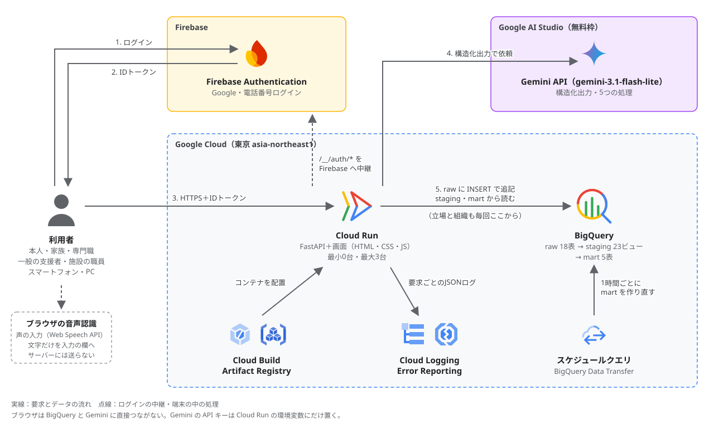

# 被災者支援つなぎ記録（仮称）

## コンペのテーマ

大会のテーマは **「Own the Why, Build with Intent.」** です。チームでは次のように解釈しました。

- **Own the Why**：プロダクトの選定を、ユーザーが責任を持って決める。
- **Build with Intent**：ユーザーの「実現したい」を起点に、狙いどおりのプロダクトを作る。

## テーマに対して作ったもの

被災者1人につき1つの記録を作り、**避難生活から仮住まい、生活再建まで**、その記録を本人と支援者の間で引き継ぐ Web アプリです。
支援者には、保健師やケアマネジャーなどの専門職だけでなく、ボランティアや離れて住む家族、受け入れ先の施設の職員も含みます。
被災者本人もログインして、自分の状態や困りごとを相談できます。

- **避難生活**：訪問した保健師などが、居場所と体調を同じ形で記録します。自分で登録するのが難しい人は、家族が代わりに登録できます。移る先が必要なときは受け入れ先の候補を確かめ、持病・薬・必要な介護を引き継ぎシートにまとめて移る先に渡します。施設の空きは、施設の職員が自分で更新します。
- **仮住まい**：相談員がボランティアや家族を見守りの担当に割り当て、担当の人が短く記録します。悪化の兆しがある人や急ぎの相談がある人が一覧の上に並び、訪ねる順番を決めやすくなります。
- **生活再建**：住宅の被害と世帯、これまでの相談から、受けられそうな支援と申請先・期限を示します。本人は自分の画面で確かめ、申請したことを記録できます。

## デプロイ後URL

**https://gdgoc-app-128905595686.asia-northeast1.run.app**

## 技術構成

| 層 | 技術 |
|---|---|
| 実行環境 | Cloud Run（東京 asia-northeast1） |
| バックエンド | Python 3.12 / FastAPI |
| フロントエンド | HTML・CSS・JavaScript（ビルドしない） |
| データ | BigQuery |
| 集計の作り直し | BigQuery のスケジュールクエリ（Data Transfer Service） |
| AI | Gemini API（Google AI Studio の無料枠・`gemini-3.1-flash-lite`・SDK は `google-genai`） |
| 認証 | Firebase Authentication |
| 声の入力 | ブラウザの音声認識（Web Speech API） |
| ログ | Cloud Logging・Error Reporting |
| デプロイ | Cloud Build・Artifact Registry |
| テスト | pytest |

## GCPアーキテクチャ

